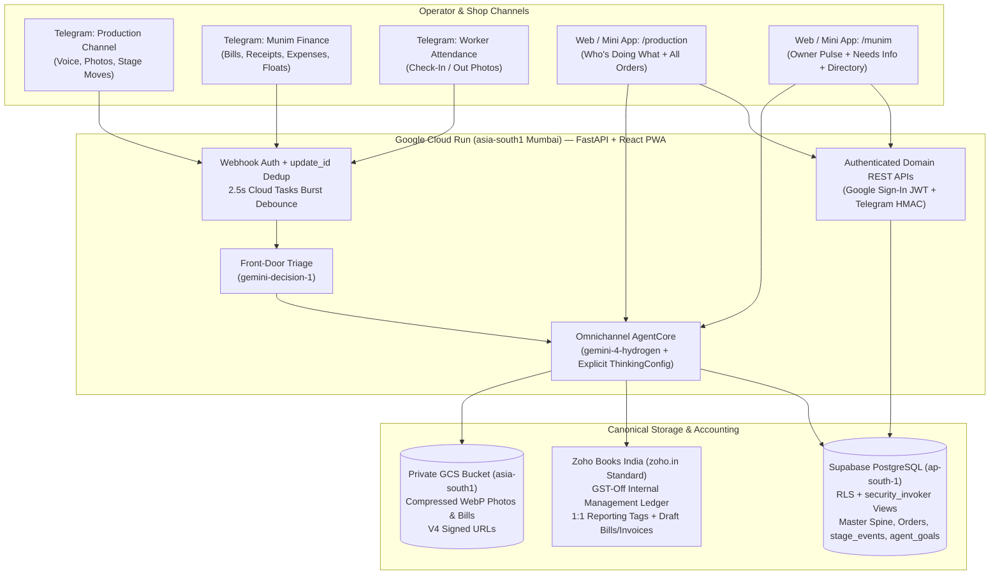

# Workshop Munim OS

**AI-native multi-domain production lifecycle, bookkeeping, and workshop operations platform** built for a custom furniture and turnkey interior manufacturing workshop in Beawar, Rajasthan, India.

Workshop Munim OS unifies day-to-day shop-floor & multi-city site execution with real-money internal management accounting—connecting **two mobile-first Web / Telegram Mini App portals** (`/production` and `/munim`) and **three purpose-built Telegram channels** (`Production`, `Munim Finance`, and `Worker Attendance`) on top of a single canonical Supabase PostgreSQL spine and Zoho Books India (`zoho.in`).

---

## System Architecture



---

## Core Domains & Capabilities

### 1. Production Lifecycle (`/production` + Production Telegram Channel)
Designed for ~4–5 office & supervisor operators (`Owner`, `Purchase/Inventory`, `Estimators`, `Clerk`) while keeping floor & site Mistris zero-login:
- **Tier 1 — Project Pipeline:** `Lead` → `Design` → `Estimating` (1+ Estimators) → `Quoted to Customer / Awaiting Advance` → `Site Sizing / BOQ` (Sizing Mistri + scope-change flag) → `Execution` → `Completed` *(+ `On Hold` / `Lost`)*.
- **Parallel Project Tracks:**
  - **Material Track:** `Check Stock` → `Ordered (Pending)` → `All In Shop` (never hidden when shop cutting starts early).
  - **Payment Track:** `Advance Pending` → `Advance In` → `Partial / Pre-Dispatch` → `Payment Complete` (auto-synced from Zoho customer receipts).
- **Tier 2 — Flat Furniture Item Execution:** `In Shop` (`production_mistri_id` preserved permanently) → `Packed / Ready` (pre-wrap check + payment badge) → `At Site` (`assembly_mistri_id`) → `QC Done`.
- **Two Action-Oriented Screens:**
  - **Who's Doing What:** `My Queue`, `Office Team Queues`, and `Mistri Floor & Site Load` with live `Days in Stage` aging badges.
  - **All Orders Board:** Unified expandable order cards, inline stage controls, `Roster Drawer`, and 1-tap price-free **WhatsApp Karigar Job Card PNG** export.

### 2. Munim Finance & HR (`/munim` + Munim Finance Telegram Channel)
- **Zoho Books India (`zoho.in` Standard Plan) as Internal Management Ledger:** Tracks 100% of gross deal values across all Bank/OD accounts, `Cash Galla`, and Supervisor Petty-Cash Floats (separate from external CA GST filings).
- **Smart Auto-Bridge & Tagging:** Pre-sales `Leads` stay strictly in Supabase so dead enquiries never clutter Zoho. On deal conversion or first financial entry, the backend auto-creates the Zoho Contact + `1:1` **Zoho Reporting Tag option** (`zoho_tag_option_id` + `cf_project_code`).
- **Draft-Strict Accounting Boundary:** Confirmed expenses, float transfers, customer receipts, and vendor advances push idempotently via deterministic `reference_number` (`MUNIM-...`), while automated **Supplier Bills and Customer Invoices are strictly created as `draft`** for clerk verification.
- **Mobile Owner Pulse & Master Directory:** Read-only live mirror of cash/bank/float balances, customer debtors, vendor dues, project P&L, canonical `Customers` / `Vendors` / `People` aliases, and OCR `historical_archive` search.
- **Worker Attendance & Monthly FnF Payroll *(Wave 2)*:** Smartphone photo check-ins/outs with server `IST` timestamps (`>6:00 PM` overtime math), mid-month advance set-off, proxy bank payout aliases, and discretionary Monthly FnF settlement sheets.

### 3. Omnichannel AI Engine (`AgentCore`)
One channel-agnostic `AgentCore` powers both Telegram channels and the persistent **Voice/Text Command Bar + `Needs Info` Drawer** inside the web apps:
- **Two-Stage Model Routing (`google-genai`):**
  - `gemini-decision-1` (`v1beta` Decisions API) for ultra-low-cost group-chatter filtering, topic routing, and photo/bill OCR legibility rubric scoring (`0..2`).
  - `gemini-4-hydrogen` (`v1` Interactions API with `previous_interaction_id` and **explicit `ThinkingConfig`**: `low` for routine Hinglish voice/text turns, `medium` for compound multi-item updates & printed bills, `high` strictly for handwritten *kacchi parchis*).
- **Quiet Personal-Assistant Contract & Risk-Tiered Autonomy:**
  - Always echoes `🎙️ Heard: "..."` on voice notes, consolidates missing slots into a single question, never sends unsolicited nag reminders, and never silently expires open `agent_goals`.
  - **Unambiguous Production Moves:** Auto-commit immediately with a 1-tap `[↩️ Undo]` button backed by `stage_events` snapshots.
  - **Money, Zoho Writes & New Entities:** Always pause with an `en-IN` formatted `₹` confirmation card (`[✅ Confirm]` `[✏️ Edit]` `[❌ Cancel]`) or entity disambiguation prompt.
  - **Self-Healing Validation:** Feeds Zoho/Supabase `400` validation errors back into Gemini to propose 1-tap fixes alongside `[📥 Let Clerk Fix Later]`.

---

## Tech Stack

| Layer | Technology |
| :--- | :--- |
| **Backend & Agent Runtime** | Python 3.12+, FastAPI, Pydantic v2, `google-genai` (`gemini-decision-1`, `gemini-4-hydrogen`, `gemini-3.5-flash-lite`) |
| **Frontend (Web & Mini App)** | React 19, Vite, Tailwind CSS (44px+ mobile touch targets, Hinglish/English labels, `en-IN` `₹` formatting) |
| **Operational DB & Auth** | Supabase PostgreSQL (`ap-south-1` Mumbai), Google Sign-In JWT + Telegram WebApp `initData` HMAC |
| **Management Accounting** | Zoho Books India API v3 (`zohoapis.in`, Standard Plan, Reporting Tags + `cf_project_code`) |
| **Media Storage** | Private Google Cloud Storage bucket (`asia-south1`), WebP compression, V4 signed URLs |
| **Serverless Infra & Jobs** | Google Cloud Run (`asia-south1`), Cloud Tasks v2 REST (2.5s burst debounce + retries), Cloud Scheduler (`08:30 IST` brief & `02:00 IST` sync/backup), Secret Manager |

---

## Repository Structure

```text
workshop-munim-os/
├── backend/
│   ├── app/
│   │   ├── main.py                  # FastAPI entrypoint & SPA static mount
│   │   ├── auth.py                  # Google JWT & Telegram initData HMAC verification
│   │   ├── config.py                # Typed environment configuration
│   │   ├── routers/                 # /api/production, /api/munim, /api/agent, Telegram & Cron
│   │   └── services/
│   │       ├── agent_core.py        # Omnichannel Interactions API loop & self-healing
│   │       ├── agent_tools.py       # Tool declarations & slot schemas
│   │       ├── decisions_triage.py  # gemini-decision-1 chatter & media triage
│   │       ├── goal_primitives.py   # Idempotency, CAS locks, stage_events Undo, INR math
│   │       ├── step_executors.py    # Production & Munim mutations
│   │       └── zoho.py              # Zoho Books India (zoho.in) Standard bridge
│   ├── tests/                       # Pytest suite (schema invariants, AgentCore, Zoho bridge)
│   └── requirements.txt             # Pinned Python dependencies
├── frontend/
│   └── src/
│       ├── App.jsx                  # /production & /munim shell + auth gate
│       ├── components/              # WhosDoingWhat, AllOrdersBoard, MunimPortal, AgentCommandBar
│       └── lib/                     # API client & WhatsApp Karigar Job Card PNG renderer
├── supabase/
│   └── migrations/                  # Sequential SQL migrations (001 .. 006)
├── scripts/
│   ├── batch_archive_ocr.py         # Historical printed PDF batch importer
│   └── seed_october_master.py       # Idempotent master directory & active orders seed
├── docs/
│   ├── BLUEPRINT.md                 # End-to-end product & technical blueprint
│   └── PROVISIONING.md              # Step-by-step GCP, Supabase, Zoho & Telegram setup
├── Dockerfile                       # Multi-stage Node 22 + Python 3.12 Cloud Run container
└── .env.example                     # Template for local environment variables (zero secrets)
```

---

## Local Development

### 1. Configure Environment
Copy `.env.example` to `.env` and populate your Supabase, Gemini, Telegram, and (optional) Zoho credentials:
```bash
cp .env.example .env
```

### 2. Run Backend & Automated Tests
```bash
python -m venv backend/.venv

# Activate virtualenv:
# Windows PowerShell: .\backend\.venv\Scripts\Activate.ps1
# macOS / Linux:      source backend/.venv/bin/activate

pip install -r backend/requirements.txt

# Run the test suite:
pytest -c backend/pytest.ini backend/tests -v

# Start FastAPI dev server on http://localhost:8000:
uvicorn app.main:app --app-dir backend --reload --port 8000
```

### 3. Run Frontend Dev Server
```bash
cd frontend
npm install
npm run dev
```

---

## Cloud Run Deployment (`asia-south1` Mumbai)

The root `Dockerfile` builds the React bundle and serves both `/production`, `/munim`, and `/api/*` from a single stateless FastAPI container:

```bash
gcloud builds submit --tag asia-south1-docker.pkg.dev/$GCP_PROJECT_ID/workshop-munim/app:latest .

gcloud run deploy workshop-munim-os \
  --image asia-south1-docker.pkg.dev/$GCP_PROJECT_ID/workshop-munim/app:latest \
  --region asia-south1 \
  --allow-unauthenticated
```

See [`docs/PROVISIONING.md`](docs/PROVISIONING.md) for Secret Manager bindings, Telegram webhook registration, Cloud Tasks queue creation, and Cloud Scheduler cron setup.

---

## Security & Architecture Invariants

- **Strict Supabase RLS:** Row Level Security is enabled on every table in `public`, every SQL view is defined `WITH (security_invoker = true)`, zero `SECURITY DEFINER` functions exist in `public`, and policies enforce `TO authenticated` paired with an active `app_users` allowlist check.
- **Zero Rigid Postgres `ENUM`s & Exact Money Math:** Lifecycle stages use row-extensible lookup tables, and all monetary columns use `NUMERIC(12,2)`.
- **Webhook & Double-Tap Safety:** Every Telegram POST verifies `X-Telegram-Bot-Api-Secret-Token`, deduplicates `update_id` in `telegram_webhook_dedup`, serializes per-user bursts via `try_lock_user_inbox()`, and guards `[Confirm]` / `[Undo]` callbacks with atomic compare-and-swap transitions.
- **Internal-Only Boundary:** The bot and AI never message external customers or suppliers directly; all external communication is generated as copy-pasteable WhatsApp drafts or price-free PNG job cards for operators.

Further documentation:
- [`GEMINI.md`](GEMINI.md) — Project rules, domain boundaries, and model invariants
- [`docs/BLUEPRINT.md`](docs/BLUEPRINT.md) — Detailed system design & operational workflows
- [`docs/PROVISIONING.md`](docs/PROVISIONING.md) — Cloud & third-party provisioning guide
