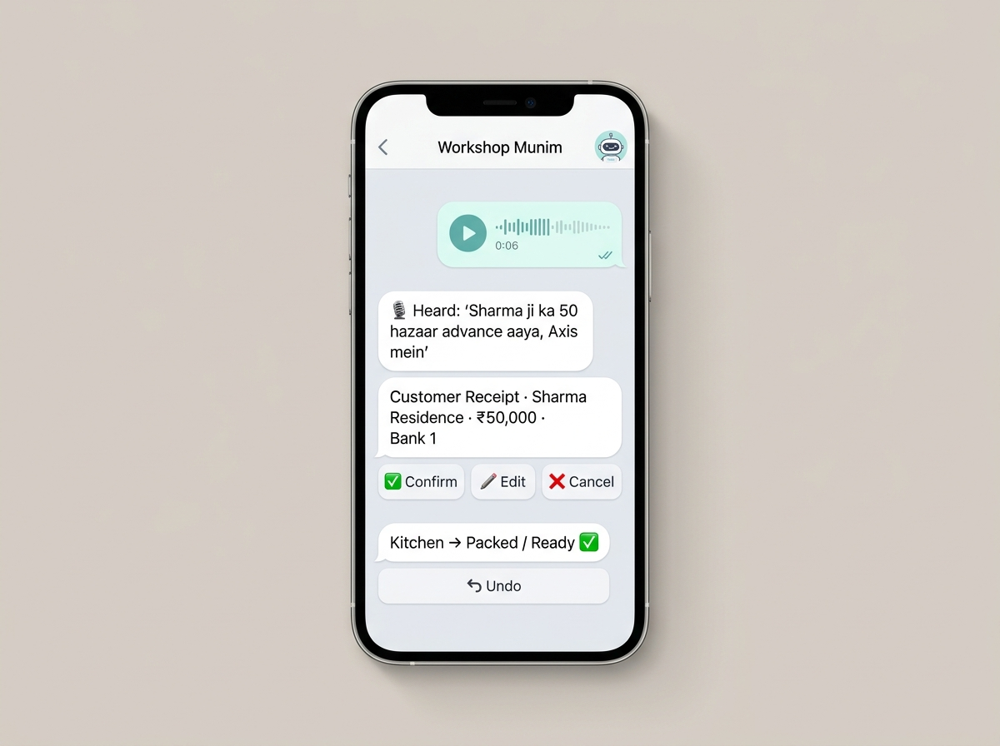
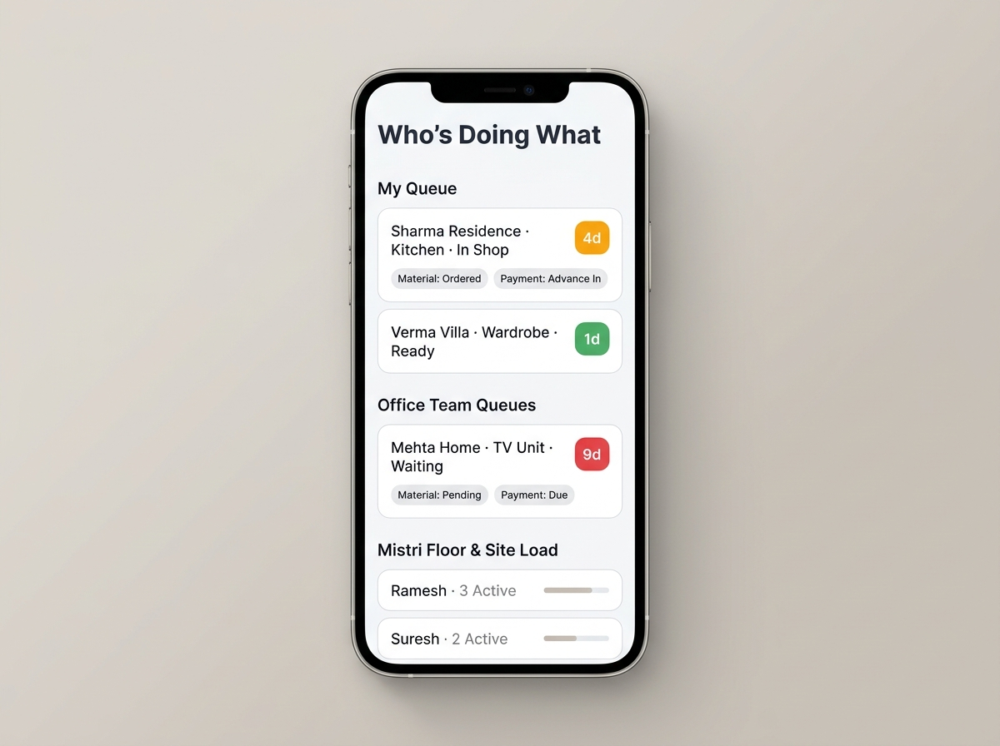
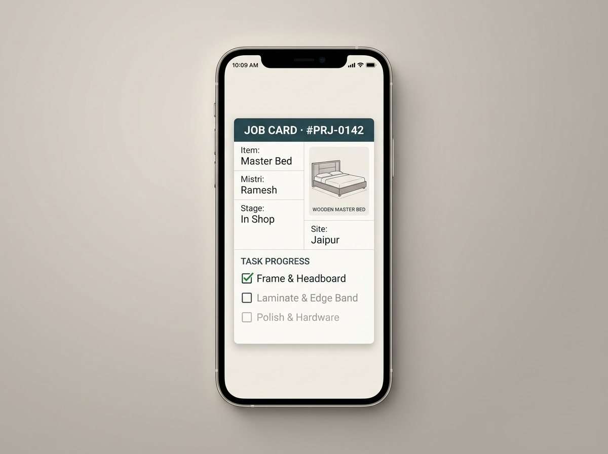
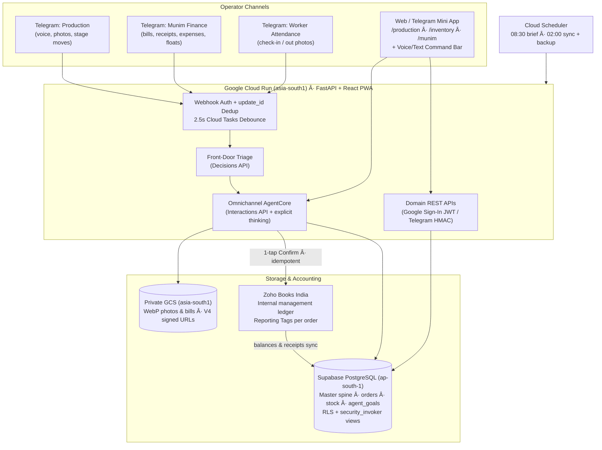

# Workshop Munim OS

**An AI back-office for a real Indian furniture workshop: staff send Hinglish voice notes on Telegram, and the books, production board, and stock ledger update themselves.**

> Built solo, and maintained remotely from the US, for a ~25-person custom furniture & turnkey interiors workshop in Rajasthan, India.

---

## The Problem

The workshop builds everything from ₹15,000 single pieces to ₹23,00,000 full-home interiors across 3+ cities. Before this system, all of it ran on **WhatsApp chats, paper *kacchi parchis* (handwritten slips), and a 27-tab spreadsheet**:

- 💸 **Money leaked from view.** Cash entries with no account, the same customer under three spellings, and `=SUM()` ranges that silently stopped one row short.
- 🤷 **Nobody knew who had the ball.** Is the kitchen still in the shop, waiting on hinges, or at the site? Answering meant phone calls.
- 📒 **Bookkeeping was a second job.** Every bill, advance, and supervisor cash float had to be retyped by a clerk.

## The Solution

One canonical database and one AI agent that the office team just *talks to*, in the same Hinglish they already use on WhatsApp.

- 🎙️ **Voice → structured books.** *"Sharma ji ka 50 hazaar advance aaya, bank mein"* becomes a confirmed customer receipt in Zoho Books, tagged to the right order, in one tap.
- 🧭 **Live "Who's Doing What" board.** Every order and every item has a single owner and a `Days in Stage` aging badge. Shop-floor karigars never log in; they get price-free job-card images on WhatsApp.
- 🛡️ **AI that knows when to ask.** Reversible production moves auto-commit with an `↩️ Undo` button. Anything touching money, new customers, or ambiguous matches always stops for a `✅ Confirm`.
- 📦 **Stock that costs itself.** Supplier bills (even photos of handwritten ones) load inventory at moving weighted-average cost, and credit (*udhaar*) clears FIFO when the supplier is paid.

### See it in action

<!-- Concept mockups: illustrative renders, not production screenshots. Replace with real (blurred) screenshots when available. -->
| Telegram agent | Who's Doing What | Karigar Job Card |
| :---: | :---: | :---: |
|  |  |  |

<sub>*Concept mockups for illustration; names and amounts are fictional.*</sub>

A typical exchange in the **Munim Finance** Telegram group (fictional data):

```text
👤 Owner:   🎤 [voice note, 0:07]

🤖 Munim:   🎙️ Heard: "Sharma ji ka 50 hazaar advance aaya bank mein,
                       aur kitchen pack ho gaya"

🤖 Munim:   ✅ Done: Sharma Residence · Kitchen → Packed / Ready
            [↩️ Undo]

🤖 Munim:   💰 Customer Receipt: please confirm
            Order:    PRJ-0142 · Sharma Residence (Jaipur)
            Amount:   ₹50,000
            Account:  Bank 1
            Payment:  Advance Pending → Advance In
            [✅ Confirm]  [✏️ Edit]  [❌ Cancel]

👤 Owner:   (taps ✅ Confirm)

🤖 Munim:   📒 Posted to Zoho Books · ref MUNIM-7f3a…  Balance due: ₹1,15,000
```

One voice note produced two actions. The **reversible** stage move committed instantly with an Undo. The **money** write waited for an explicit confirmation.

---

## Engineering Highlights

The hard parts were never CRUD. They were making an LLM agent safe to point at a real company's books.

| Problem | Approach |
| :--- | :--- |
| **LLM + money = risk** | **Risk-tiered autonomy.** Reversible production moves auto-commit with `stage_events` snapshots for 1-tap Undo. Money writes, new entities, and ambiguous matches always pause for confirmation or disambiguation. Customer invoices are only ever created as `draft`. |
| **Retries must never double-post** | Every Zoho write stamps a deterministic `goal_step_id` into `reference_number` and queries for it before any retry. `429/5xx` errors retry via Cloud Tasks backoff; only `400` validation errors wake the LLM to propose a 1-tap fix or `📥 Let Clerk Fix Later`. |
| **Telegram bursts & 4G double-taps** | Secret-token verification, `update_id` dedup, a 2.5s Cloud Tasks debounce per `(chat, user)` with a Postgres advisory lock, and atomic compare-and-swap on every `Confirm` / `Undo` callback. |
| **Multi-day, cross-channel conversations** | Canonical goal state lives in Postgres (`agent_goals`: collected slots, missing slots, checkpointed steps), not in the model context. Goals never silently expire, and unfinished ones park in a `Needs Info` drawer. |
| **LLM cost on a small-business budget** | Two-stage routing. A cheap Decisions-API model filters group chatter and classifies photos/OCR difficulty; the main agent runs with an **explicit** thinking level (`low` for routine turns, `medium` for printed bills, `high` only for handwritten slips). |
| **Data security** | Row Level Security on every table, `security_invoker` views, no `SECURITY DEFINER` in `public`, allowlist-backed `TO authenticated` policies, HMAC-verified Telegram `initData`, and private GCS media served only via short-lived signed URLs. |
| **Inventory without an ERP** | Hybrid design: physical stock and weighted-average cost live in Supabase, money and COGS journals post to Zoho Books Standard, and project P&L comes from Zoho Reporting Tags instead of a pricier plan tier. |

**Testing:** 97 pytest cases across 14 suites cover schema/RLS invariants, AgentCore turns, the Zoho bridge, the inventory ledger, and Telegram concurrency. A golden-turn eval script (`scripts/eval_golden_turns.py`) regression-checks real Hinglish inputs.

---

## System Architecture



---

## Domains

All three domains share one Postgres master spine (`customers`, `vendors`, `people`, `payment_accounts`, `projects`). Leads stay in Supabase; a Zoho contact and order tag are created automatically only when a deal converts.

### 🏭 Production (`/production`)
- **Project pipeline:** `Lead → Design → Estimating → Quoted / Awaiting Advance → Site Sizing / BOQ → Execution → Completed` (+ `On Hold` / `Lost`).
- **Parallel tracks:** Material (`Check Stock → Ordered → All In Shop`) and Payment (auto-synced from Zoho receipts).
- **Item cards:** `In Shop → Packed / Ready → At Site → QC Done`, remembering both the shop and the site mistri.
- **Screens:** *Who's Doing What* (my queue, office queues, mistri floor & site load) and *All Orders* (expandable board, roster drawer, WhatsApp Job Card PNG export).

### 📦 Inventory (`/inventory`)
- Workshop stock, a *To Buy & Gate-In* list, and an immutable stock ledger.
- Supplier bill photo → line items → stock load at moving weighted-average cost, with paid-now, credit (*udhaar*), or rate-pending settlement.
- 3-layer semantic matching of incoming receipts to open purchase lines; asset/COGS journals and per-order material cost in Zoho.

### 📒 Munim & HR (`/munim`)
- **Bookkeeping:** expenses, fund transfers to supervisor wallets, customer receipts, vendor advances, and supplier bills, each pushed to Zoho after a 1-tap confirmation.
- **Owner Pulse:** a read-only mobile mirror of cash, banks, wallets, debtors, vendor dues, and project P&L.
- **Attendance & payroll:** photo check-in/out in a Telegram group, server-side IST timestamps, overtime after 6:00 PM, month-tagged advances, and a discretionary monthly settlement sheet.
- **Master directory:** customers, vendors, people, aliases, and a searchable historical archive.

> Full stage definitions, schema tables, and model matrix: [`docs/BLUEPRINT.md`](docs/BLUEPRINT.md) · Inventory spec: [`docs/INVENTORY_MODULE.md`](docs/INVENTORY_MODULE.md)

---

## Tech Stack

| Layer | Technology |
| :--- | :--- |
| **Backend & agent** | Python 3.12, FastAPI, Pydantic v2, `google-genai` (Decisions API triage + Interactions API agent + Batch API for archive OCR) |
| **Frontend** | React 18, Vite 6, Tailwind CSS 3: mobile-first PWA and Telegram Mini App, 44px+ touch targets, Hinglish/English labels, `en-IN` ₹ formatting |
| **Database & auth** | Supabase PostgreSQL (Mumbai), Google Sign-In, Telegram WebApp `initData` HMAC |
| **Accounting** | Zoho Books India API v3 (`zohoapis.in`), Reporting Tags + custom fields |
| **Media** | Private Google Cloud Storage (Mumbai), WebP compression, V4 signed URLs |
| **Infra** | Cloud Run, Cloud Tasks, Cloud Scheduler, Secret Manager, Cloud Build |

---

## Repository Map

```text
workshop-munim-os/
├── backend/
│   ├── app/
│   │   ├── main.py, auth.py, config.py, db.py
│   │   ├── routers/
│   │   │   ├── telegram.py, cron.py            # Webhooks, scheduled jobs
│   │   │   └── domains/                        # production, inventory, munim, agent APIs
│   │   └── services/
│   │       ├── agent_core/                     # Turn loop, grounding, slot resolvers, amendments
│   │       ├── step_executors/                 # Production, materials, inventory, munim mutations
│   │       ├── zoho/                           # Client, contacts, bills, ledger, inventory journals, sync
│   │       ├── decisions_triage.py             # Front-door chatter & media triage
│   │       ├── goal_primitives.py              # Idempotency, CAS, Undo snapshots, INR math
│   │       └── storage.py, sheets_backup.py, telegram_api.py, …
│   └── tests/                                  # 14 pytest suites
├── frontend/src/
│   ├── App.jsx                                 # Domain shell + auth gate
│   ├── components/                             # WhosDoingWhat, AllOrdersBoard, InventoryPortal, MunimPortal, AgentCommandBar, …
│   └── lib/                                    # API client, Job Card PNG renderer
├── supabase/migrations/                        # 001 … 010 sequential SQL migrations
├── scripts/                                    # Seed, cutover, archive OCR, golden-turn evals, deploy_prod.sh
├── docs/                                       # Blueprint, provisioning, inventory spec, cutover guide
├── Dockerfile                                  # Node 22 build → Python 3.12 runtime, single container
└── .env.example                                # Config template (no secrets)
```

---

## Running Locally

```bash
cp .env.example .env            # fill in Supabase, Gemini, Telegram, (optional) Zoho

# Backend
python -m venv backend/.venv
source backend/.venv/bin/activate      # Windows: .\backend\.venv\Scripts\Activate.ps1
pip install -r backend/requirements.txt
pytest -c backend/pytest.ini backend/tests -v
uvicorn app.main:app --app-dir backend --reload --port 8000

# Frontend (separate terminal)
cd frontend && npm install && npm run dev
```

## Deploying

A single stateless container on Cloud Run (`asia-south1`) serves `/production`, `/inventory`, `/munim`, and `/api/*`:

```bash
./scripts/deploy_prod.sh              # runs tests, builds, deploys  (--skip-tests, --with-firebase)
```

See [`docs/PROVISIONING.md`](docs/PROVISIONING.md) for Secret Manager bindings, Telegram webhook registration, Cloud Tasks queues, and Scheduler jobs, and [`docs/CLEAN_SLATE_CUTOVER.md`](docs/CLEAN_SLATE_CUTOVER.md) for go-live data loading.

---

## Documentation

| Doc | What's inside |
| :--- | :--- |
| [`docs/BLUEPRINT.md`](docs/BLUEPRINT.md) | End-to-end product & technical design |
| [`docs/INVENTORY_MODULE.md`](docs/INVENTORY_MODULE.md) | Inventory & procurement spec |
| [`docs/PROVISIONING.md`](docs/PROVISIONING.md) | GCP, Supabase, Zoho & Telegram setup |
| [`docs/CLEAN_SLATE_CUTOVER.md`](docs/CLEAN_SLATE_CUTOVER.md) | Reset & go-live cutover |
| [`PRIVACY.md`](PRIVACY.md) | What personal data is processed, where, and for how long |
| [`GEMINI.md`](GEMINI.md) · [`AGENTS.md`](AGENTS.md) | Rules for AI coding agents working in this repo |

---

## License & Privacy

© 2026 Rishabh Jain. **All rights reserved.** The source is published for viewing and evaluation only; see [`LICENSE`](LICENSE). The operating workshop holds a perpetual, royalty-free license to use and modify it.

The system processes staff and customer personal data on behalf of the workshop. See [`PRIVACY.md`](PRIVACY.md).
