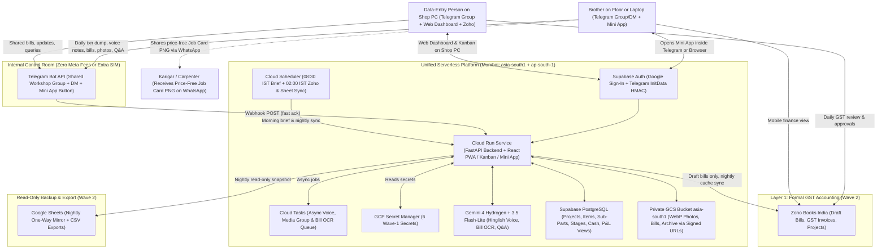

# Technical Blueprint: Custom Furniture Workshop OS (Beawar, Rajasthan)

**TL;DR:** Today, the workshop runs across WhatsApp threads, phone calls, and manual bills, leaving customer project progress, required materials, receivables, supplier dues, and per-order profit unclear. Because custom furniture manufacturing combines multi-item builds (such as a bed, almirah, and study table for one customer) with both formal GST invoices and informal cash expenses, neither pure accounting software nor standalone boards work in isolation.

We will build a unified two-layer system upfront before handover: Zoho Books India as the formal GST financial backbone, paired with a serverless Google Cloud Run + GCS + Supabase (PostgreSQL, Auth) operational platform powering an internal Telegram Bot (`Workshop Munim`) with an embedded Telegram Mini App Production Dashboard, nightly read-only Google Sheets backups, and zero VMs or Meta API bureaucracy to maintain.

---

## 1. Unified Architecture & Why This Stack Fits

Production tracking, material lists, cash expenses, and customer billing all tie back to the same customer project. Hosting both the Telegram assistant and the visual dashboard on one Cloud Run + Supabase stack means every voice note updates the dashboard immediately, and every dashboard tap updates live SQL rollups without dual-entry bugs.



### Key Architectural Decisions Resolved
- **Why Telegram Bot + Mini App over WhatsApp Business Cloud API:** Once passive scraping of his main WhatsApp is parked, Telegram beats WhatsApp Cloud API on every axis—created in 2 minutes via `@BotFather`, ₹0/month with no spare SIM, no Meta Business Verification or card billing issues, free unrestricted 8:30 AM briefs with no template approvals, native `media_group_id` for multi-photo bursts, unlimited inline confirmation buttons, optional 3-person shared internal group (`Brother + Data-Entry Person + Bot`), and a pinned `Open Dashboard` Mini App button inside Telegram itself. The only trade-off is sharing WhatsApp bills/photos via the phone's Share sheet (`Share → Telegram → Workshop Munim`, 1 extra tap vs. in-app Forward).
- **Why Supabase (PostgreSQL + Auth + Storage) over Firestore or Raw Google Sheets:** A three-level relational model (Customer Project → Furniture Items → Required Materials) plus financial aggregations (per-order P&L, running cash-box balance, cross-customer Master Purchase List) fits PostgreSQL natively via real foreign keys and SQL views (`SUM`, `GROUP BY`, `JOIN`) instead of fragile NoSQL client-side scans or broken spreadsheet `SUMIFS`. Hosting Supabase in Mumbai (`ap-south-1`) alongside Cloud Run (`asia-south1`) keeps mobile latency crisp in Beawar.
- **Why Zoho Books India over Vyapar or TallyPrime:** Zoho Books India provides cloud access across the shop PC, your brother's phone, and your laptop remotely, supports Indian GST/e-way bills and per-order job costing via Projects, and exposes clean REST APIs (`zohoapis.in`) so the bot can push draft supplier bills and sync formal balances nightly.
- **Why Nightly One-Way Google Sheet Backup:** Keeping PostgreSQL as the sole operational write store eliminates bidirectional sync conflicts while still giving your brother and data-entry staff a familiar read-only spreadsheet mirror and 1-click CSV exports.
- **Why Serverless Cloud Run over a Virtual VM:** Every integration is webhook or REST API driven. Cloud Run scales to zero, needs zero OS patching or SSH maintenance from abroad, and serves both the Telegram webhook and web dashboard from one container.

---

## 2. Workshop Production & Materials Dashboard (Telegram Mini App + Browser)

Accessible either via one tap on the pinned `Open Dashboard` menu button inside Telegram (zero extra login via verified Telegram `initData`) or on laptop/shop PC browser via Supabase Google Sign-In allowlisted to your brother, the data-entry person, and you.

### 2.1 Primary Views & Navigation
1. **Customer Projects Board (Default Home View):**
   - Shows one clean card per active customer (filterable by overdue delivery, material blocked, or payment pending).
   - Example card: `Sharma Ji` — Delivery: `25 Nov` | Paid: `₹40,000 / ₹1,15,000` (Formal + Cash) | Items: `Teak Bed [Polish]`, `6-Door Almirah [Carpentry]`, `Study Table [Material Pending]`.
   - Clicking a Customer opens the **Customer Workspace**, displaying all furniture pieces with inline reference photo galleries, dimensions, assigned karigar, tap-to-change stage selector, per-item material checklists, follow-up reminders, and live SQL-computed combined Zoho + Cash P&L.
2. **Floor Stage Kanban (One-Tap Toggle):**
   - Groups individual furniture pieces across six workshop columns: `Design & Measurement` → `Material Pending` → `Carpentry` → `Polish / Upholstery` → `Ready` → `Delivered`.
   - Highlights bottlenecks immediately (for example, 4 pieces queued in Polish or 3 blocked on material) and supports direct tap/drag stage updates.
3. **Master Purchase List (Cross-Customer Material Rollup):**
   - Backed directly by PostgreSQL view `v_master_purchase_list`, rolling up every `Needed` material across all active customer items grouped by category (`Ply / Wood`, `Laminate / Sunmica`, `Hardware`, `Foam / Fabric`, `Polish / Adhesive`) with expandable customer breakdowns (for example: `18mm BWP Plywood — 14 sheets total: Sharma Ji Almirah (6), Verma Ji Bed (5), Gupta Ji Table (3)`).
   - Your brother opens this tab before calling suppliers, orders everything in one phone call, and taps rows from `Needed` → `Ordered` → `In Shop`.
4. **1-Click "Share Karigar Job Card" (Shop-Floor Handoff):**
   - Every furniture item card includes a `Share Karigar Card` button generating a clean vertical PNG/PDF card showing only: Customer Short Code + Item Name, Reference Photos, Dimensions & Specs, Assigned Karigar, Target Date, and Required Materials list.
   - All customer quotes, invoice totals, and balances are stripped so your brother can tap-share the card directly into his karigar's WhatsApp chat.
5. **Back-Office Tabs (For Data-Entry Person & Owner):**
   - **Cash & Karigar Ledger:** Filterable SQL table of informal inflows/outflows with running cash-box balance, `Verified` checkboxes, and 1-click CSV export.
   - **Follow-Ups:** Open customer callbacks and supplier check-ins sorted by due date.
   - **Entity Dictionary & Historical Archive:** Manage Hinglish/Rajasthani phonetic aliases and search pre-cutoff legacy bills with instant signed-URL previews.

---

## 3. Data Model (Zoho Books + Supabase PostgreSQL)

### 3.1 Layer 1: Zoho Books India (Formal GST Books)
- **Contacts:** Customers and Raw Material Suppliers with GSTINs and payment terms.
- **Projects (1:1 per Customer Project):** One Zoho Project per formal order (`PRJ-2026-041 - Sharma Ji Full Bedroom`) linking formal GST customer invoices and formal supplier material bills.
- **Draft-Only Bot Boundary:** The Telegram bot only creates supplier bills or invoices in `draft` status. The data-entry person verifies GST rates, HSN codes, and totals on the shop PC before approving and sending official PDFs via Zoho Books.

### 3.2 Layer 2: Supabase PostgreSQL Schema (`ap-south-1` Mumbai)

| Table / View | Purpose | Key Columns |
| :--- | :--- | :--- |
| `projects` | Customer-level order container linked to Zoho Project | `id` (UUID), `project_code` (unique, e.g. `PRJ-2026-041`), `customer_name`, `phone`, `zoho_contact_id`, `zoho_project_id`, `quoted_total` (`NUMERIC(12,2)`), `gst_flag`, `promised_delivery_date`, `status` (`active / completed / on_hold`), `zoho_invoiced_cache`, `zoho_bills_cache`, `created_at` |
| `project_items` | Individual furniture pieces built per customer (Bed, Almirah, Study Table) | `id` (UUID), `project_id` (FK), `item_name`, `category`, `dimensions`, `specs_notes`, `stage` (`design_measurement / material_pending / carpentry / polish_upholstery / ready / delivered`), `assigned_karigar`, `target_date`, `photo_paths` (`TEXT[]`), `updated_at` |
| `item_materials` | Structured material requirements per furniture piece | `id` (UUID), `project_id` (FK), `item_id` (FK), `category` (`ply_wood / laminate / hardware / foam_fabric / polish`), `material_name`, `quantity` (`NUMERIC(10,2)`), `unit` (`sheets / pcs / kg / ft`), `status` (`needed / ordered / in_shop`), `preferred_supplier`, `notes`, `updated_at` |
| `cash_ledger` | Informal/cash inflows & outflows kept out of GST books | `id` (UUID), `txn_date`, `txn_type` (`cash_advance / cash_balance / karigar_labor / local_transport / misc`), `direction` (`in / out`), `party_or_karigar`, `project_id` (FK nullable), `item_id` (FK nullable), `amount_inr` (`NUMERIC(12,2)`), `payment_mode`, `notes`, `logged_by`, `verified_by_staff` |
| `followups` | Customer callbacks & supplier check-ins | `id` (UUID), `due_date`, `entity_type`, `name`, `phone`, `project_id` (FK nullable), `action_note`, `status` (`open / done`), `source_msg_id` |
| `entity_dictionary` | Grounding lexicon injected into Gemini prompts | `id` (UUID), `canonical_name`, `entity_type`, `aliases` (`TEXT[]`, e.g. `{'Ramesh Mistri', 'Ramu'}`), `phone`, `zoho_contact_id` |
| `historical_archive` | Searchable pre-cutoff legacy bills from batch OCR | `id` (UUID), `doc_type`, `doc_date`, `party_name`, `invoice_no`, `amount_inr` (`NUMERIC(12,2)`), `gst_amount`, `paid_status`, `storage_path`, `extracted_items` (`JSONB`) |
| `telegram_state` | Webhook deduplication (`update_id` UNIQUE), media-group grouping, and pending Confirm/Edit payloads | `id` (UUID), `telegram_update_id` (UNIQUE), `chat_id`, `user_id`, `media_group_id`, `pending_actions` (`JSONB`), `status` (`pending / confirmed / cancelled`), `expires_at` |
| `v_master_purchase_list` (SQL View) | Real-time aggregated material shopping list across active projects | `category`, `material_name`, `unit`, `total_qty_needed`, `customer_breakdown` (`JSONB`) |
| `v_project_pnl` (SQL View) | Real-time combined formal (Zoho cache) + informal (Cash Ledger) order profitability | `project_id`, `customer_name`, `formal_invoiced`, `cash_in`, `total_revenue`, `formal_bills`, `cash_out`, `total_cost`, `net_profit`, `margin_pct`, `balance_pending` |

### 3.3 Google Cloud Storage Bucket Layout (`asia-south1`, Private, Auto-Compressed WebP/JPEG)
```text
gs://{GCS_STORAGE_BUCKET}/
  ├── projects/{project_id}/{item_id}/photos/{timestamp}_{name}.webp
  ├── projects/{project_id}/{item_id}/job_cards/{timestamp}_card.png
  ├── supplier_bills/YYYY-MM/{date}_{vendor}_{inv_no}.{pdf|webp}
  └── historical_archive/{doc_type}/{date}_{party}_{inv_no}.{pdf|webp}
```
Compressing uploaded photos to max 1600px WebP (~150KB each) keeps GCS Standard storage in `asia-south1` at a few rupees per month with no 1GB hard cap, served strictly via short-lived V4 signed URLs or authenticated backend proxy.

---

## 4. Core Telegram Assistant Workflows (`Workshop Munim`)

Runs either as a direct 1-on-1 bot chat with your brother (and separately with the data-entry person) or inside a single shared 3-member internal Telegram group (`Brother + Data-Entry Person + Workshop Munim`), locked down via a strict `telegram_user_id` allowlist in Cloud Run.

### 4.1 Hinglish Voice-Note Capture (Multi-Item Progress, Materials, Cash, Follow-Ups)
- **Example Voice Note:** *"Sharma ji ka bed polish mein chala gaya, almirah ke liye 6 sheet 18mm ply aur 2 walnut sunmica chahiye, aur Ramesh karigar ko 4,000 cash diya hai."*
- **Pipeline:** Cloud Run fetches the Telegram `.ogg` voice note and passes it directly to `gemini-4-hydrogen` (`low` thinking for quick capture, `medium` for multi-item updates) along with active `projects`/`project_items` and `entity_dictionary`, returning strict JSON actions.
- **Tiered Safety Reply (3–5 seconds):**
  - Action 1: Update Item Stage | `Sharma Ji — Teak Bed` → `Polish / Upholstery`
  - Action 2: Add Materials (`Needed`) | `Sharma Ji — Almirah`: `6 sheets 18mm Ply`, `2 sheets Walnut Sunmica`
  - Action 3: Log Cash Out ₹4,000 | Payee: `Ramesh Mistri` | Project: `Sharma Ji`
  - Inline Telegram Keyboard: `[✅ Confirm All]` `[✏️ Edit]` `[❌ Cancel]`
- **Commit:** Tapping `Confirm All` writes atomically in a single PostgreSQL transaction and edits the Telegram message in place with a clean logged receipt; the Mini App Dashboard reflects changes immediately.

### 4.2 Supplier Bill Photo / PDF Sharing to Zoho Books Drafts
- **Example Action:** Brother shares a supplier PDF or bill photo from WhatsApp into Telegram (`Share → Telegram → Workshop Munim`) with an optional voice note or caption.
- **Pipeline:** Gemini extracts Supplier Name, GSTIN, Invoice Number, Date, Line Items, Taxable Value, GST Split, and Total. Cloud Run checks Zoho Books and `historical_archive` for duplicate `(Supplier + Invoice_No + Amount)` entries.
- **Output:** Uploads the bill to Supabase Storage, creates a Draft Bill in Zoho Books (linked to the Zoho Project if single-customer), and posts a summary card for the data-entry person to verify and approve on the shop PC.

### 4.3 Multi-Photo Design Capture via Native `media_group_id`
- **Example Action:** Brother shares 4 sofa/almirah reference photos at once from WhatsApp into Telegram along with a caption or voice note (*"Yeh Sharma ji ke study table ka design hai, 4x2 ft, white matte finish"*).
- **Output:** Telegram tags all 4 photos with one `media_group_id`. Cloud Run compresses and uploads them to `projects/{project_id}/{item_id}/photos/`, asks for 1-tap confirmation, and immediately renders them in the Customer Workspace and Karigar Job Cards.

### 4.4 Live Q&A Over Production, Materials, Zoho & Cash
- **Example Questions:**
  - *"Sharma ji ka kaam kahan tak pahuncha aur kitna baki hai?"* → Queries `project_items` + `v_project_pnl` in Postgres (refreshing Zoho receivables on demand).
  - *"Total kitni 18mm ply mangwani hai sab orders milake?"* → Reads `v_master_purchase_list` directly in <5ms.
  - *"Is hafte kaunse delivery due hain?"* → Filters active `projects` and `project_items` due within 7 days, highlighting pieces not yet `Ready`.
  - *"Patel plywood ka October ka bill kitna tha?"* → Checks Zoho Books + `historical_archive` fallback.

### 4.5 AI-Drafted Customer & Supplier Messages (Strictly Internal)
- **Example Voice Note:** *"Sharma ji ko message bana de ki bed aur study table ready hai, almirah parso ho jayegi, Friday ko delivery kar denge."*
- **Output:** Bot sends a standalone polite Hindi/Hinglish text message (with no preamble) plus a quick copy/share flow so your brother pastes or forwards it directly to Sharma Ji on WhatsApp.

### 4.6 Automated 8:30 AM IST Daily Morning Brief
- **Trigger:** Cloud Scheduler invokes `POST /cron/morning-brief` at 08:30 IST daily (no templates, no Meta fees, rich Markdown formatting + an inline `📊 Open Dashboard` Mini App button).
- **Compact Contents (4 bullets max):**
  - Deliveries due today & next 3 days (flagging pieces still in `Material Pending` or `Carpentry`)
  - Items currently blocked in `Material Pending` (with count on the Master Purchase List)
  - Customer follow-ups & overdue customer/supplier dues (Zoho + Cash)
  - Unverified Zoho Draft Bills waiting on the data-entry person

---

## 5. Daily Operating Rhythm

| Role | Daily Cadence | Responsibilities |
| :--- | :--- | :--- |
| Brother (Owner) | Real-time (2–3 mins/day) + quick Mini App check | Reads 8:30 AM Morning Brief in Telegram; drops Hinglish voice notes for stage updates, materials needed, and cash payouts; taps `Open Dashboard` inside Telegram to inspect customer builds, call suppliers using the Master Purchase List, and share price-free Karigar Job Cards to WhatsApp. |
| Data-Entry Person | 30–45 mins at shop PC (evening) | Verifies and approves bot-created Draft Bills in Zoho Books; generates & sends official customer GST invoices/estimates from Zoho; reviews newly added item specs and unverified `cash_ledger` entries in the Web Dashboard; maintains `entity_dictionary` aliases. |
| Local CA | Monthly / Quarterly | Receives clean GSTR-1, GSTR-3B, and purchase register exports directly from Zoho Books India, cleanly separated from informal karigar cash logs. |
| You (Remote Setup / Admin) | Near-zero post-launch | Receives automated Cloud Run error alerts if an API call fails; handles rare schema or prompt updates. |

---

## 6. Historical Backlog Cutover Strategy

- **Step 1 (Clean Cutoff Date):** Start Zoho Books fresh from a crisp cutoff date (for example, the 1st of next month), seeding only currently open customer receivables, unpaid supplier balances, and active workshop builds.
- **Step 2 (One-Time Batch Archive Script):** Put all existing customer invoice PDFs, Word docs, and supplier bill photos into one local folder. Run a one-time Python script using `gemini-3.5-flash-lite` via the Gemini Batch API (50% discount) for clean printed bills, falling back to `gemini-4-hydrogen` for blurry handwritten slips. Upload compressed files to Supabase Storage `/historical_archive/` and insert rows into `historical_archive` (and seed `entity_dictionary` with real Beawar customer and supplier names).
- **Step 3 (Instant Searchability):** Both the Web Dashboard's Historical Archive tab and the Telegram bot query pre-cutoff bills immediately via PostgreSQL full-text search without polluting Zoho Books GST filings.

---

## 7. Critical Engineering Gotchas (Build Checklist)

- **Telegram Webhook Security & Allowlist:** Set a secret token via `setWebhook(secret_token=...)` and verify the `X-Telegram-Bot-Api-Secret-Token` header on every POST; restrict all bot commands and Telegram Mini App `initData` HMAC verification strictly to your brother's, data-entry person's, and your `telegram_user_id`s.
- **Webhook Idempotency & Fast Ack:** Deduplicate `update_id` in `telegram_state` and acknowledge Telegram quickly (using Cloud Tasks for heavy Gemini OCR + Zoho API writes) so Telegram never retries long-running updates.
- **Supabase Free Tier Inactivity Pause Prevention:** Supabase Free tier pauses projects after 7 days of zero DB activity. Our daily 08:30 IST Morning Brief and 02:00 IST Zoho sync query PostgreSQL twice daily, guaranteeing it never hits the 7-day pause threshold.
- **GCS Storage & Image Compression:** Resize/compress uploaded photos to max 1600px WebP (~150KB/photo) before uploading to the private `asia-south1` GCS bucket (`Uniform Bucket-Level Access`). Never make the bucket public; serve media via short-lived V4 signed URLs or authenticated backend endpoints.
- **Zoho Books India Regional Endpoints:** Always use `https://www.zohoapis.in/books/v3` and `https://accounts.zoho.in` (never `.com`). Mint a Self-Client OAuth `refresh_token`, store it in GCP Secret Manager, and cache short-lived access tokens.
- **Model Routing & Pricing Hygiene:** Use `gemini-4-hydrogen` (\$1.50/1M input, \$7.50/1M output; `low` thinking for fast captures, `medium` for handwritten bill OCR and multi-step Q&A) as the primary live model—or `gemini-3.8-flash` during its introductory window (\$0.75/\$3.75 per 1M tokens through Dec 31, 2026). Use `gemini-3.5-flash-lite` (\$0.30/\$2.50; 50% off on Batch API) for simple routine lookups and historical batch OCR.
- **Hinglish & Multi-Item Prompt Grounding:** Inject `entity_dictionary` plus active `projects` and `project_items` names (<2,500 tokens, eligible for prompt caching) into Gemini's system prompt so phrases like *"Sharma ji wali badi almirah"* resolve deterministically to the exact `project_id` and `item_id`.
- **Nightly Zoho Cache + Read-Only Sheet Backup (`02:00 IST`):** One Cloud Scheduler job refreshes `zoho_invoiced_cache` and `zoho_bills_cache` on active Postgres projects (so `v_project_pnl` loads instantly) and exports a one-way read-only snapshot of all tables into a backup Google Sheet.
- **Pre-Launch Checks (Before Writing Code):** Confirm with your brother's CA that Zoho Books GSTR exports work cleanly for his filings, and confirm your brother is comfortable logging informal cash transactions in cloud storage (or scope the ledger strictly to formal + production/materials if he prefers).

---

## 8. Estimated Monthly Running Cost

| Component | Tier / Plan | Monthly Cost (INR) | Monthly Cost (USD) |
| :--- | :--- | :--- | :--- |
| Zoho Books India | Free Plan (if annual turnover < ₹25L) or Standard Plan | ₹0 – ₹749 (+GST) | \$0 – \$9.00 |
| Telegram Bot API + Mini App | Official Bot API (no extra SIM, no template/message fees) | ₹0 | \$0 |
| Supabase (`ap-south-1` Mumbai) | Free Tier (500MB Postgres + Auth + 1GB Storage; daily cron prevents auto-pause) | ₹0 | \$0 |
| GCP Cloud Run (`asia-south1`) + Cloud Scheduler + Cloud Tasks | Well within GCP free tier for 2 internal users | ₹0 – ₹100 | \$0 – \$1.20 |
| Gemini API (`gemini-4-hydrogen` + `gemini-3.5-flash-lite`) | ~30–60 voice notes, bill OCRs, and Q&As/day (`low` thinking + caching; `3.5-flash-lite` for routine/batch) | ~₹200 – ₹600 | \$2.40 – \$7.20 |
| Google Sheets (Nightly One-Way Backup) | Existing Google Account | ₹0 | \$0 |
| **Total Estimated Cost** | **Full production stack (Telegram Bot + Mini App Dashboard + Postgres + GST Books)** | **~₹200 – ₹1,450/mo (+GST on Zoho)** | **~\$2.40 – \$17.40/mo** |

---

## 9. Complete Pre-Handover Build Sequence

1. **Prerequisites & Accounts (Day 1 — ~1 Hour Total):**
   - Create `Workshop Munim` bot via `@BotFather` on Telegram and save the bot token (no SIM or verification wait!).
   - Provision one Supabase project in Mumbai (`ap-south-1`), run the SQL schema + `v_master_purchase_list` & `v_project_pnl` views, and enable Google Sign-In.
   - Set up Zoho Books India organization (GSTIN, branding, furniture HSN codes, Projects enabled, Self-Client OAuth refresh token).
   - Create one GCP project (`asia-south1`) enabling Cloud Run, Cloud Tasks, Cloud Scheduler, Secret Manager, Sheets API (backup), and Gemini API.
2. **Historical Archive & Seed Data (Days 2–3):**
   - Run the one-time Gemini Batch OCR script (`gemini-3.5-flash-lite` + `gemini-4-hydrogen` fallback) over existing customer/supplier bills → upload compressed files to Supabase Storage `/historical_archive/` and populate `historical_archive` + `entity_dictionary`.
   - Seed currently active customer builds (`projects`, `project_items`, `item_materials`) and open Zoho Books balances.
3. **Backend Bot + Unified API on Cloud Run (Days 4–8):**
   - Build FastAPI service handling Telegram webhooks (secret token verification, `telegram_user_id` allowlist, `update_id` dedup, Cloud Tasks async worker, native `media_group_id` photo batching), Gemini multimodal router, REST endpoints for the dashboard, 08:30 IST Morning Brief, and 02:00 IST Zoho cache + read-only Google Sheet backup.
4. **Mobile-First Telegram Mini App & Web Dashboard (Days 9–12):**
   - Build React/Tailwind PWA served from the same Cloud Run container (authenticating via Telegram `initData` inside Telegram and Supabase Google Auth in desktop browser): Customer Projects Board, Customer Detail Workspace (items, photo galleries, tap-to-edit stages & materials, SQL P&L), 6-Stage Floor Kanban, Master Purchase List, 1-click Karigar Job Card PNG export (Web Share API to WhatsApp), Cash Ledger, Follow-Ups, and Historical Archive search.
   - Configure the Telegram bot menu button to launch the Mini App directly inside Telegram.
5. **Shadow Testing & Handover Day (Days 13–14):**
   - End-to-end test with 15–20 realistic Hinglish voice notes (multi-item updates, material requests, cash payouts), handwritten supplier bills, multi-photo bursts, and Karigar Job Card sharing to WhatsApp.
   - Install Telegram on your brother's phone, pin `Workshop Munim` (or the 3-member workshop group), and walk both your brother and the data-entry person through one full order lifecycle.
