# Unified Technical Blueprint: Custom Furniture & Turnkey Interior Workshop OS (Beawar, Rajasthan)

**TL;DR:** Today, the workshop tracks ₹40L+ of monthly movements, ~18 salaried workers, piece-rate contractors, and multi-city custom furniture / turnkey interior builds (`₹15K` pieces up to `₹23L` full-home builds across Beawar, Jaipur, Ajmer, Chittorgarh) across WhatsApp chats, manual bills, and a 27-tab spreadsheet—causing hidden Debtor conflicts, blank-account cash entries, silent `=SUM()` drops, and lost visibility on *"who has the ball right now."*

We unite everything over **one canonical Supabase PostgreSQL Master Data Spine** (`customers`, `vendors`, `people`, `payment_accounts`, `projects`), surfaced cleanly through **2 dedicated web/Mini App domains** (`Production Lifecycle` and `Munim & HR`), **3 purpose-built Telegram channels** (`Production`, `Munim Finance`, `Worker Attendance`), **Zoho Books India as the 100% GST-Off Internal Management Book of Record**, and a channel-agnostic, self-healing **AI-Native `AgentCore`** (`gemini-decision-1` + `gemini-4-hydrogen` Interactions API).

---

## 1. Multi-Domain Topology & Omnichannel AI Architecture

```mermaid
flowchart TD
    subgraph Channels["3 Dedicated Telegram Channels + In-App Command Bars"]
        TG_PROD["1. Production Channel & /production Command Bar (Shreyansh, Ansh, Estimators)"]
        TG_FIN["2. Munim Finance Channel & /munim Command Bar (Shreyansh, Ansh, Clerk)"]
        TG_ATT["3. Worker Attendance Group (~18 Salaried Workers' Smartphones)"]
    end

    subgraph AI["AI-Native AgentCore (Cloud Run + Cloud Tasks, asia-south1)"]
        DEC["Front-Door Router & Rubric Triage (Decisions API: gemini-decision-1, $0 out)"]
        HYDRO["Bounded Tool-Calling + Self-Healing Loop (Interactions API: gemini-4-hydrogen)"]
    end

    subgraph Spine["Shared Master Data Spine (Supabase PostgreSQL, ap-south-1)"]
        MD["customers · vendors · people (operators, karigars, proxy aliases) · payment_accounts"]
        OPS_DB["projects · project_items · stage_events · agent_goals · workshop_memory"]
        HR_DB["worker_attendance · worker_advances · monthly_fnf_settlements · owner_pulse_cache"]
    end

    subgraph Domains["2 Focused Web / Mini App Domains + True Accounting Engine"]
        APP_PROD["Domain 1: Production Lifecycle (/production — Who's Doing What + All Orders)"]
        APP_MUNIM["Domain 2: Munim & HR (/munim — Attendance/FnF + Owner Pulse + Master Directory)"]
        ZOHO["Zoho Books India — 100% Internal Management Book (GST-Off: 8 Banks, Cash Galla, 4 Floats, Debtors, Vendors)"]
    end

    TG_PROD --> DEC
    TG_FIN --> DEC
    TG_ATT --> DEC
    DEC --> HYDRO
    HYDRO <--> MD
    HYDRO <--> OPS_DB
    HYDRO <--> HR_DB
    HYDRO -->|"1-Tap Confirm -> Instant Push (Bills/Invoices strictly as Drafts)"| ZOHO
    ZOHO -->|"Syncs Balances & Auto-Updates Payment Track"| Spine
    APP_PROD <--> OPS_DB
    APP_MUNIM <--> HR_DB
```

---

## 2. Domain 1: Production Lifecycle (`/production` + Production Channel)

Built strictly for the **~4–5 Office/Supervisor Operators** (`Shreyansh`, `Ansh`, `Estimator(s)`, `Clerk`). Mistris and Karigars **never log into the web apps**; they are tracked as named assignees, appear in a dedicated **Mistri Floor & Site Load** view, and receive price-free **WhatsApp Job Card PNGs**.

### 2.1 Locked Two-Tier Lifecycle + Parallel Tracks (`v1`)
1. **Tier 1 — Project Pipeline (Customer-Level Pre-Production → Closeout):**
   - `1. Lead` *(Owner: Shreyansh)*
   - `2. Design` *(Owner: Shreyansh / Designer)*
   - `3. Estimating` *(Owner: **1+ Estimators**; pings assigned Estimator(s); advancing stamps `Estimate Completed` milestone in `stage_events`)*
   - `4. Quoted to Customer / Awaiting Advance` *(Surfaces aging >3d)*
   - `5. Site Sizing / BOQ` *(Sizing Mistri named + optional sizing sheet photo + **Scope-Change Check**: `Matches Estimate` vs `Extra Work Re-quoted`)*
   - `6. Execution` *(Auto-starts Ansh's Material Track & pings Ansh; unlocks flat Item cards)*
   - `7. Completed` *(All items `QC Done` + `Payment Complete`; plus `On Hold` / `Lost` side states)*
2. **Parallel Project Tracks (Never Hidden When Shop Work Starts Early):**
   - **Material Track (Default Owner: `Ansh`, 3 states):** `Check Stock` → `Ordered (Pending)` → `All In Shop`.
   - **Payment Track (Smart Auto-Bridge from Zoho/Munim):** `Advance Pending` → `Advance In` → `Partial / Pre-Dispatch` → `Payment Complete`.
3. **Tier 2 — Flat Item Execution Cards (`'Kitchen'`, `'Master Bed'`, `'Almirah'` — 4 Physical-State Stages):**
   - `1. In Shop` *(Saves `production_mistri_id` permanently + 1-tap WhatsApp Job Card)*
   - `2. Packed / Ready` *(Manual 2-min Head Karigar pre-bubble-wrap shop check + optional photo + Pre-Dispatch Payment badge)*
   - `3. At Site` *(Saves `assembly_mistri_id` separately while keeping `Shop: <Mistri>` visible)*
   - `4. QC Done` *(`Shreyansh / Head Karigar` pass-only milestone once informal WhatsApp snags are cleared)*

### 2.2 Streamlined 2-Screen UI + Four Manual Shop Habits
- **Screen 1 — `Who's Doing What`:** `My Queue` (for logged-in operator) + `Office Team Queues` (`Estimators`, `Ansh`, `Shreyansh`) + `Mistri Floor & Site Load` (`Days in Stage` aging pills).
- **Screen 2 — `All Orders`:** Unified customer board expanding inline into Material Pill, Payment Pill, flat Item pills, and full **Order Workspace** (`Who did what` timeline) + `Team & Mistri Roster` drawer.
- **Paired Shop Habits:** (1) **5-Minute 6:30 PM Clerk/Ansh "Board Sweep"**, (2) **Pre-bubble-wrap shop check**, (3) **BOQ Scope-Change gate**, and (4) **`#ProjectCode` marker on ply/bundles**.

---

## 3. Domain 2: Munim & HR (`/munim` + Munim Finance & Attendance Channels)

### 3.1 Zoho Books = 100% Internal Management Book (GST-Off, Standard Plan ~₹749/mo)
- Uses **Zoho Books India Standard Plan (~₹749/mo)**—linking orders `1:1` via **Zoho Reporting Tags (`Project` tag option)** + `cf_project_code` / `reference_number` instead of paying ₹1,499/mo for Zoho Professional's `Projects` module.
- Records **100% of real money at gross deal value** across:
  - **8 Bank / OD Accounts:** `Axis`, `RGB`, `CCRGB`, `ICICI`, `IDFC`, `SBI`, `Canara Bank`, `Paytm`.
  - **Physical Shop Cash:** `Cash Galla`.
  - **4 Supervisor Floats (`Petty Cash`):** `Prakash Ji Float`, `Kamlesh Bhaiya Float`, `Manu Bhaiya Wallet`, `Ansh Wallet` (handling both upfront floats via `Transfer Fund` and negative out-of-pocket site spending until reimbursed).
  - **Zoho Vendors:** Raw material suppliers (`Abhinandan`, `RP Wood`, `Shivam Traders`, `Polo`) + piece-rate job contractors (`Manish Cushioning`, `Sunil False Ceiling`), using native **Zoho Vendor Advances** settled against Order-tagged Bills.
- **Official GST tax invoices & Tally GSTR filings** are handled separately with the Beawar CA.
- **Smart Auto-Bridge:** `Leads` stay in Supabase only; Zoho Contact + `1:1` Zoho `Project` Reporting Tag option auto-create when a deal converts (`Advance In` / first financial entry).
- **Instant Push, Idempotency & Draft Boundary:** Every Zoho write stamps deterministic `goal_step_id` in `reference_number` (queried before retry; `429/5xx` auto-retry silently via Cloud Tasks while `400` triggers LLM repair). Expenses, Float Transfers, Customer Receipts, Vendor Advances, and Salary Payouts push to Zoho immediately upon 1-tap `[✅ Confirm]`; automated **Supplier Bills and Customer Invoices strictly land as `Draft`** for Clerk verification inside Zoho Books.

### 3.2 Worker Attendance (`>6:00 PM` OT) & Monthly FnF Payroll
- **Self-Phone Photo Check-In/Out:** ~18 salaried workers post factory/site arrival & departure photos from their own smartphones in the **Telegram Attendance Group** → matched via `telegram_user_id → people.id`, timestamped in `IST`, compressed to private GCS, with missed check-outs flagged automatically.
- **Automated Hours + Discretionary Monthly FnF Sheet:** Tracks daily hours, `>6:00 PM` overtime hours, absent days, and month-tagged salary advances (`Oct Adv` / `Nov Adv`, including proxy transfers like `Ruksar Bano → Lala Ji`); Shreyansh/Clerk review & approve final earned pay on the 1st–5th and push payouts to Zoho.

### 3.3 Focused 3-Screen `/munim` App
1. **Worker Attendance & Monthly FnF Payroll**
2. **Mobile "Owner Pulse" Dashboard** (read-only Zoho mirror: `Cash Galla`, `Banks`, `Floats`, `Debtors`, `Vendor Dues`, `Project P&L`)
3. **Shared Master Directory & Archive** (`Customers`, `Vendors`, `People`, `Payment Accounts`, aliases, and pre-cutoff `historical_archive`)

---

## 4. AI-Native `AgentCore` & Model Routing (`google-genai >= 3.2.0`)

### 4.1 Model & Thinking-Level Matrix
| Pipeline Role | API & Model | Thinking | Pricing (Paid) | Purpose |
| :--- | :--- | :--- | :--- | :--- |
| `Front-Door Gate & Media Triage` | **Decisions API** (`client.decisions.create`, `gemini-decision-1`, `v1beta`) | Single pass | **\$0.10/1M in, \$0 out** | Surgical front-door gate ONLY where it avoids waking Hydrogen or classifies media: casual group-text filter, photo/PDF kind + `ocr_difficulty` rubric (`0..2`), attendance photo check, and async `workshop_memory` edit gate. |
| **Routine Live Agent (~85% turns)** | **Interactions API** (`client.interactions.create`, `gemini-4-hydrogen`, `v1`) | **`low`** *(explicit)* | \$1.50 in (\$0.075 cached) / \$7.50 out | Receives compact `<=3` active open goals + tools (`resolve_open_goal` + `create_goal`) so compound sentences both answer an open question and start a new task; uses `previous_interaction_id` strictly within-turn while Postgres `agent_goals` holds canonical multi-day state. |
| **Compound Dumps, Printed Bills & Self-Healing** | **Interactions API** (`gemini-4-hydrogen`) | **`medium`** | \$1.50 in / \$7.50 out | Multi-entry cash/float splitting, printed GST bills, and translating Zoho/Supabase errors into 1-tap fixes. |
| **Blurry / Handwritten *Kacchi Parchis*** | **Interactions API** (`gemini-4-hydrogen`) | **`high`** *(on-demand)* | \$1.50 in / \$7.50 out | Prevents hallucinated invoice numbers/amounts on crumpled handwritten slips. |
| **Historical Clean Printed PDFs** | **Batch API** (`gemini-3.5-flash-lite`) | **`low`** | \$0.15 in / \$1.25 out | One-time legacy printed PDF archive only. |

### 4.2 Goal-Oriented Safeguards
1. **Homonym Disambiguation & Fast Customer Onboarding:** Checks `customers` (active + past) + Zoho Contacts before acting (`[Existing Active Order]` / `[Repeat Customer — New Lead]` / `[➕ New Customer: Full Name + Site Area + Rough Scope]`).
2. **Risk-Tiered Autonomy:** Unambiguous Production lifecycle moves **auto-commit + `[↩️ Undo]`**; money/Zoho writes, new entities, and ambiguities always pause to ask/confirm first (requiring explicit `payment_account` so blank-account rows never recur).
3. **Multi-Goal Topic Switching:** Unrelated new messages open a fresh `agent_goal` while keeping unfinished clarifications parked in the **`Needs Info (N)`** drawer.
4. **Step-Checkpointed Self-Healing:** Completed Supabase/GCS steps never duplicate on retry; Zoho/DB errors generate plain Hinglish 1-tap repair buttons + **`[📥 Let Clerk Fix Later]`**.

---

## 5. Unified Data Spine Schema (`006_unified_multi_domain_and_agent.sql`)

| Table / View | Role Across Domains | Key Columns |
| :--- | :--- | :--- |
| `customers` | Canonical customer identity (`1:N` projects, `1:1` Zoho Contact) | `id`, `full_name`, `area_landmark`, `phone`, `zoho_contact_id`, `aliases[]`, `metadata` |
| `vendors` | Raw material suppliers + piece-rate contractors (`Manish Cushioning`, `Sunil`) | `id`, `canonical_name`, `vendor_kind` (`supplier \| contractor`), `zoho_contact_id`, `aliases[]`, `phone` |
| `people` | Office operators, ~18 salaried karigars, and Mistri roster | `id`, `full_name`, `person_type` (`operator \| salaried_karigar \| contractor_mistri`), `role_tags[]`, `email`, `telegram_user_id`, `payout_aliases[]`, `linked_vendor_id`, `monthly_salary_inr`, `is_default_purchase`, `is_default_qc` |
| `payment_accounts` | Canonical Banks, `Cash Galla`, and Supervisor Floats (`1:1` Zoho) | `id`, `code`, `display_name`, `account_kind` (`bank \| cash_galla \| float`), `zoho_account_id`, `custodian_person_id` |
| `projects` | Customer order container (`Tier 1` pipeline + parallel tracks + Zoho Standard link) | `id`, `project_code`, `customer_id`, `rough_scope`, `pipeline_stage`, `material_stage`, `payment_stage`, `boq_scope_changed`, `current_owner_ids[]`, `sizing_mistri_id`, `material_owner_id`, `zoho_tag_option_id`, `quoted_total`, `paid_cache_inr`, `cost_cache_inr` |
| `project_items` | Flat execution cards (`'Kitchen'`, `'Master Bed'`) | `id`, `project_id`, `item_name`, `item_stage` (`in_shop \| packed_ready \| at_site \| qc_done`), `production_mistri_id`, `assembly_mistri_id`, `qc_passed_by_id`, `stage_entered_at`, `photo_paths[]` |
| `stage_events` | Immutable audit, duration analytics & 1-tap `[Undo]` snapshots | `id`, `project_id`, `item_id`, `track`, `from_stage`, `to_stage`, `assigned_people_ids[]`, `actor_person_id`, `duration_hours`, `is_undone` |
| `telegram_inbox_buffer` | 2.5s burst debounce & `update_id` dedup for rapid-fire messages | `telegram_update_id`, `chat_id`, `user_id`, `payload`, `batch_claimed_at`, `processed_at` |
| `agent_goals` | Canonical omnichannel state checklist (zero silent expiry), checkpoints & repairs | `id`, `owner_person_id`, `source_channel`, `domain_scope`, `goal_type`, `status`, `heard_transcript`, `collected_slots`, `missing_slots`, `steps[]`, `repair_options[]`, `undo_event_ids[]` |
| `worker_attendance` | Daily Telegram photo check-ins, check-outs & `>6:00 PM` OT | `id`, `person_id`, `work_date`, `check_in_at`, `check_out_at`, `in_photo_path`, `out_photo_path`, `worked_minutes`, `overtime_minutes`, `status` |
| `worker_payroll_entries` & `monthly_fnf_sheets` | Month-tagged salary advances (`Oct Adv`) & discretionary Monthly FnF | `person_id`, `salary_month`, `entry_type` (`advance \| fnf_payout \| bonus_adjustment`), `amount_inr`, `payment_account_id`, `zoho_txn_id` |

---

## 6. Explicit Scope Boundaries & `October main` Cutover

- **Permanently Excluded:** Pre-sales BOM / brand-tier quote calculators (costing stays external).
- **Parked (`v2` Backlog):** Structured BOQ verification (`estimated_qty` vs `verified_boq_qty`), Ansh shop stock check (`v_master_purchase_list`), and Factory Gate-In / Site Material Challans + Returnable Tools.
- **`October main` Full Historical Replay (`1 Oct+`):** Automated normalization script splits the 9 slash-separated rows, fixes the 6 `Debit/Credit` inversions, generates a 15-minute Clerk sign-off sheet for the ~20 blank-account / Debtor-conflict rows, seeds the Shared Master Spine (`~35 customers`, `~30 vendors`, `~18 workers + proxy aliases`, `13 payment accounts`), and replays `1 Oct+` transactions cleanly into Zoho Books + Worker Khata.
