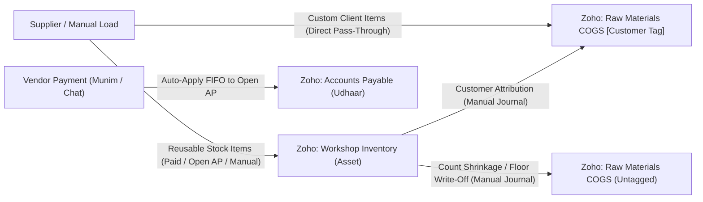

# Workshop Inventory & Procurement Module — Product & Technical Spec

**Status:** Implemented (`009_inventory_module.sql`)  
**Target App:** Workshop Munim OS (Beawar Custom Furniture & Turnkey Interior Workshop)  
**Navigation Route:** `/inventory` (**`📦 Inventory`** top-level domain alongside `🏭 Production` and `📒 Munim`)

---

## 1. Overview, Architecture Philosophy & Scope Boundaries

### 1.1 Why Hybrid Supabase Stock + Zoho Books Standard (`zoho.in`)
External retail/e-commerce inventory tools (Zoho Inventory at ₹999–₹2,299/mo, Zoho Books Professional at ~₹1,499/mo, Vyapar, or manufacturing ERPs like Katana/Odoo) are designed around buying SKUs and reselling those same SKUs on sales invoices—or enforcing rigid BOM issue slips for identical factory batches.

A custom interior workshop works differently:
- You buy **raw materials** (`18mm Gurjan Ply`, `Fevicol Marine`, `Soft-Close Hinges`, custom laminates/veneers) and invoice **finished custom builds** (`Modular Kitchen + Master Bed — ₹4,50,000`).
- External inventory apps cannot auto-deduct raw materials from customer invoices, cannot support unpriced *kacchi parchi* tempo deliveries (`Rate Pending`), and know nothing about Supabase `Leads`, `OrderDetailDrawer`, or Hinglish Telegram voice commands.

Keeping **physical workshop stock & customer material allocation in Supabase (`📦 Inventory`)** while pushing **100% of `₹` accounting entries into the existing Zoho Books India Standard Plan (~₹749/mo)** gives ₹0/mo extra SaaS cost, zero two-database sync drift, and full support for workshop realities.

### 1.2 Explicit Scope Boundaries

#### In Scope (`v1` Inventory)
1. **Standing Workshop Stock Catalog (`inventory_items`) & Movement Ledger (`inventory_movements`):** Starts **clean & empty** (zero dummy rows in migration `009_inventory_module.sql`). Operators add reusable SKUs anytime via `[+ Add SKU]` or inline directly inside `[+ Load Stock]` with Hinglish `aliases[]`, `on_hand_qty`, `min_stock_qty`, and **Moving Weighted Average `avg_unit_cost_inr`**.
2. **CUJ 1 — Check Stock, 1-Tap `Pull from Stock` & Consolidated `To Buy`:**
   - Match open order `To Order` (`needed`) lines against live workshop stock and support 1-tap **`[Pull from Stock]`** (including partial pulls).
   - Direct **`[→ Attribute to Customer]`** from `📦 Workshop Stock` onto any Customer Order.
   - Merged workshop-wide **`🛒 To Buy & Gate-In`** table consolidating all open customer order needs + low-stock SKUs (no vendor grouping, no WhatsApp PO generator).
3. **CUJ 2 — Unified Stock Load & Gate-In (Web UI + AI/Telegram):**
   - Multi-line mixed receipts supporting **Workshop Stock** lines (selecting an existing SKU or typing a new reusable SKU inline) + **Direct Custom Client** lines in a single load/bill.
   - Settlement modes: **`Paid Now`** (Cash/Bank/Float), **`Vendor Udhaar / Credit`** (posts directly as `Open` Accounts Payable in Zoho + auto-clears FIFO on vendor payments, unified with Munim supplier bills), **`Opening / Manual Load`** (no formal bill required), and **`Rate Pending`** (unpriced delivery *parchi* loads physical qty now, `₹` entered later).
   - Unlisted custom client items arriving on a receipt auto-match existing `To Order`/`Ordered` rows or **auto-add** as `In Shop` onto the customer's `item_materials` list.
4. **Order-Level Customer Attribution, Physical Count Write-Offs & Same-Day Undo:**
   - Make `item_materials.item_id` **nullable** so stock/materials can be attributed to a Customer Order overall (picking a specific furniture item like `Kitchen` is optional).
   - Support physical stock count adjustments (`± Count Adjust`) that write off floor shrinkage/shared consumables to untagged General Shop COGS in Zoho.
   - Support **Same-Day `[↩️ Undo]`** on `📜 Stock Ledger` rows (reversing Zoho Expenses / Open AP Bills / Journals via `mutations.py` and restoring exact prior stock qty & avg rate).
5. **Semantic Matching (`To Order` / `Ordered` ↔ Incoming Invoice Lines):** Instant `<1ms` local Hinglish/alias/category matching in the Web `Fulfills` dropdown + native `gemini-4-hydrogen` matching on AI/photo/voice turns + partial-delivery splitting.

#### Explicitly Parked (`v2` Backlog)
- Outstation Site Material Challans & Leftover *Wapsi* (`CUJ 4`)
- Returnable Power Tool & Machine Custody (`CUJ 5`)
- Post-project **`1-Tap Leftover-to-Stock`** reversal on custom client materials
- Preferred-vendor grouping and WhatsApp PO text builder in `To Buy`
- Pre-sales BOM / structured `estimated_qty` vs `verified_boq_qty` BOQ variance math

---

## 2. Navigation, Access & 3-Sub-Tab UI (`/inventory`)

### 2.1 Top-Level Header & Access Control
- **Header Switcher (`frontend/src/App.jsx`):** Add **`📦 Inventory`** (`/inventory`) as a 3rd top-level domain tab alongside **`🏭 Production`** (`/production`) and **`📒 Munim`** (`/munim`).
- **Access Control:** Keep login and visibility identical for all authenticated app users (`app_users` allowlist)—**no module-specific access gating** for now.
- **Table Layout Rule:** Use **flat, sortable tables** across `📦 Inventory` (NO category group headers and NO vendor grouping). Render `Category` (`material_categories`) as a regular sortable/filterable attribute column alongside `Material`, `Qty`, `Unit`, `Avg Rate ₹`, `Value ₹`, etc.

### 2.2 Sub-Tab 1 — `📦 Workshop Stock`
- **Top KPI Strip:**
  - `Total Stock Value` (`∑ on_hand_qty × avg_unit_cost_inr`, formatted with `en-IN` `₹1,15,000`)
  - `Low Stock` (count of active SKUs where `on_hand_qty <= min_stock_qty`)
  - `Rate Pending` (count of unpriced `inventory_movements` awaiting `₹` rate)
- **Filter & Sort Bar:** Search by material name / Hinglish alias, quick filter pills (`All`, `Low Stock`), `Category` filter dropdown, and column sorting (`Material`, `Category`, `On Hand`, `Avg Rate ₹`, `Stock Value ₹`).
- **Flat Sortable SKU Table & Row Actions:**
  - Columns: `Material` (+ aliases subtext), `Category`, `On Hand` (+ `Low Stock` amber badge when `<= min_stock_qty`), `Avg Rate ₹`, `Value ₹`, `Actions`.
  - Primary Header / Row Actions (44px+ mobile touch targets):
    - **`[+ Load Stock]`** — Opens multi-line Load / Gate-In modal (supports single SKU restock or mixed Stock + Direct Customer bill/challan).
    - **`[→ Attribute]`** — Select Customer Order (Furniture Item optional), `Qty` (defaults up to `on_hand_qty`), preview `Qty × Avg Rate ₹` (`en-IN`), confirm to deduct stock, mark/create order material `In Shop`, and post Zoho Journal.
    - **`[± Count]`** — Enter actual physical shop count; computes delta (`+` or `-`) and posts Stock Count Adjustment (with optional note, e.g., *"Friday rack sweep / floor screws consumed"*).
    - **`[+ Add / Edit SKU]`** — Create or edit `name`, `category`, `unit`, `min_stock_qty`, `aliases[]` (e.g., `["18mm ply", "gurjan 18", "18mm sheet"]`), and `avg_unit_cost_inr` (used to pre-fill loads).

### 2.3 Sub-Tab 2 — `🛒 To Buy & Gate-In`
- **Unified Flat Sortable Table:** Consolidates all open demand across the workshop:
  1. All active customer order `item_materials` rows with `status IN ('needed', 'ordered')` (aggregated by normalized material + unit across orders, showing expandable/inline customer breakdown: e.g., *Ambure Ji: 15, Sharma Ji: 6*).
  2. Any `inventory_items` where `on_hand_qty <= min_stock_qty` (labeled `Workshop Restock`).
- **Columns:** `Material`, `Category` (sortable/filterable attribute), `Needed Qty`, `In Stock` (live `on_hand_qty` if linked/matched to a stock SKU), `Status` (`To Order` / `Ordered` / `Low Stock`), `Orders`, `Actions`.
- **Inline Actions:**
  - **`[Pull from Stock]`** — Visible whenever `In Stock > 0` for a customer `To Order` row; executes partial or full attribution from `inventory_items`, updates order line(s) to `In Shop`, and posts the Zoho Journal.
  - **`[Mark Ordered]`** — Flips `needed` (`To Order`) lines to `ordered` (auto-syncing each project's `Material Track` to `ordered_pending`).
  - **`[Gate-In]`** — Opens `[+ Load Stock]` pre-filled with that `ordered` material & customer breakdown.

### 2.4 Sub-Tab 3 — `📜 Stock Ledger`
- **Chronological Movement Audit Log:** Flat sortable/filterable list of every `inventory_movements` entry (`Load / Gate-In`, `Customer Attribution`, `Direct Order Receipt`, `Count Adjust`).
- **Columns / Card Fields:** Date (`IST`), Type badge, Material & Qty delta (`+20 sheets` / `-12 sheets`), Target (`Workshop Stock` or `Customer #PRJ-104`), Unit Rate `₹`, Total `₹`, Settlement (`Paid: Axis`, `Udhaar: RP Wood`, `Manual`, or `Rate Pending`), and Zoho Sync Status (`Synced`, `Rate Pending`, `Stubbed`, `Needs Fix`).
- **`Rate Pending` Filter & 1-Tap `[Enter Rate]`:**
  - Filtering by `Rate Pending` isolates unpriced Gate-Ins.
  - Tapping **`[Enter Rate]`** lets Shreyansh/Clerk enter the `₹` unit rate (or total `₹`) + settlement mode (`Paid Now` + account, `Vendor Udhaar` + vendor, or `Manual`).
  - Saving updates `avg_unit_cost_inr` (for stock lines) and pushes the Zoho accounting entry **without modifying physical `on_hand_qty` a second time**.

### 2.5 Production Cross-Domain Shortcut (`OrderDetailDrawer.jsx`)
- Inside `🏭 Production` → `OrderDetailDrawer.jsx` (`🪑 Furniture Items` & `🪵 All Materials` tabs):
  - When a `To Order` (`needed`) material matches an `inventory_items` SKU with `on_hand_qty > 0`, show an inline **`🟢 <X> in Stock · [Pull]`** button.
  - Support adding/viewing order-wide materials (`item_id IS NULL`) directly from `🪵 All Materials` as well as item-specific materials (`Kitchen`, `Master Bed`).

---

## 3. Zoho Books India (`zoho.in` Standard Plan) Accounting Specification

### 3.1 Money & Cost Flow



### 3.2 Moving Weighted Average Cost (Zero Balance Drift)
For every SKU in `inventory_items`:
- **On Priced Stock Load (`+qty_in` at `unit_cost_in`):**
  $$\text{new\_total\_value} = (\text{old\_qty} \times \text{old\_avg\_cost}) + (\text{qty\_in} \times \text{unit\_cost\_in})$$
  $$\text{new\_avg\_cost} = \text{ROUND}\left(\frac{\text{new\_total\_value}}{\text{old\_qty} + \text{qty\_in}}, 2\right)$$
- **On Customer Attribution or Count Write-Off (`-qty_out`):**
  - Valued at current `avg_unit_cost_inr`.
  - When `on_hand_qty` reaches `0`, total inventory value for that SKU in Zoho `Workshop Inventory (Asset)` reaches `₹0.00` (with remainder-cent guard on the final unit hitting `0` so no ₹0.01 rounding residue ever lingers).

### 3.3 Settlement Modes on Stock Load / Gate-In (CUJ 2)
All Zoho writes use deterministic `reference_number` idempotency (`goal_step_id` / `inv_mov_<id>`) and query before retry.

| Load Mode | Physical Effect (Immediate) | Zoho Books Entry (`zohoapis.in/books/v3`) | Notes |
| :--- | :--- | :--- | :--- |
| **`Paid Now`** (`Axis`, `Cash Galla`, `Ansh Wallet`, etc.) | `+on_hand_qty` (Stock) and/or `In Shop` (Customer) | `POST /expenses` (`paid_through_account_id`, multi-line `line_items[]` with per-line `account_id` + `tags`) | Debits `Workshop Inventory (Asset)` for stock lines and `Raw Materials COGS [Project Tag]` for direct custom lines. |
| **`Vendor Udhaar / Credit`** | `+on_hand_qty` (Stock) and/or `In Shop` (Customer) | `POST /bills` in **`Open` AP status**, multi-line `line_items[]` | Immediately increases Vendor AP + `Workshop Inventory (Asset)` / Customer COGS without requiring manual Zoho Books login (unified with Munim unpaid supplier bills; Customer Invoices remain `Draft`). |
| **`Opening / Manual Load`** | `+on_hand_qty` (Stock) | `POST /journals` (`Debit Workshop Inventory (Asset)` / `Credit Opening Balance Equity` or `Stock Adjustment`) | Used when loading existing shop stock or manual rate adjustments without a cash/vendor bill. |
| **`Rate Pending`** | `+on_hand_qty` (Stock) and/or `In Shop` (Customer) | **None yet** (`zoho_sync_status = 'rate_pending'`) | When `[Enter Rate]` is filled later, pushes the selected `Paid Now` / `Open AP` / `Manual` entry and updates `avg_unit_cost_inr` without re-adding qty. |

### 3.4 Automatic FIFO Settlement for `Udhaar` Vendor Payments
- Currently `backend/app/services/zoho/ledger.py` (`entry_kind == "vendor_payment"`) posts `POST /vendorpayments` without linking open bills.
- **Required Upgrade:** When recording a `vendor_payment` in Munim or via AgentCore:
  1. Query `GET /bills?vendor_id={vendor_id}&status=open` (and `partially_paid` if applicable), sorted oldest `date` first (FIFO).
  2. Allocate `amount_inr` across open bills' `balance` into `bills: [{"bill_id": ..., "amount_applied": ...}]`.
  3. Post `POST /vendorpayments` with `bills[]` attached (any surplus beyond open AP naturally remains on the vendor as an unapplied Vendor Advance).
- Result: Ansh/Clerk never need a bill-closing UI or Zoho Books web login to settle *Udhaar*.

### 3.5 Customer Attribution, `"Workshop Inventory"` Asset Auto-Create & Physical Count Adjustments (`/journals`)
- **OAuth Scope Addition (`docs/PROVISIONING.md`):** Add `ZohoBooks.accountants.ALL` to the Zoho Self-Client scopes alongside existing scopes so `POST /journals` and `GET /journals` are authorized.
- **Asset Account Resolution:** Automatically matches an existing `"Workshop Inventory"` / `"Inventory Asset"` / `"Stock"` account in `/chartofaccounts` — or auto-creates `"Workshop Inventory"` (`account_type: "other_current_asset"`) once via `POST /chartofaccounts` if missing.
- **Customer Attribution Journal (`POST /journals`):**
  - Line 1 (`debit`): `Raw Materials COGS` account, `amount = ROUND(qty × avg_unit_cost_inr, 2)`, **`tags: [Customer Project Reporting Tag]`** (+ `cf_project_code` / `customer_id` where supported).
  - Line 2 (`credit`): `Workshop Inventory (Asset)` account, `amount = ROUND(qty × avg_unit_cost_inr, 2)`.
- **Physical Count Write-Off (`POST /journals`):**
  - Negative count delta (shrinkage/floor consumables): `Debit Raw Materials COGS` (untagged General Shop) / `Credit Workshop Inventory (Asset)`.
  - Positive count gain (found stock): `Debit Workshop Inventory (Asset)` / `Credit Stock Count Variance / COGS` (untagged).
- **Same-Day `[↩️ Undo]`:** Stock Ledger rows created on the current IST day support 1-click `[↩️ Undo]`, deleting/voiding the Zoho entry (`mutations.py`, including `/journals/{id}`) and restoring prior stock qty & weighted avg rate.

### 3.6 Line-Level Project P&L Sync (`backend/app/services/zoho/sync.py`)
- Update `sync_project_financial_caches()` in `backend/app/services/zoho/sync.py`:
  - Fetch `/invoices`, `/bills`, `/expenses`, and `/journals` (non-void).
  - Because **mixed supplier receipts** and **manual journals** carry Reporting Tags **per `line_item`** (not only at the document header), sum matched **`line_item` amounts** whenever a document contains line-level tags (falling back to document `total` only when a single project tag sits at the header with untagged lines), ensuring `projects.zoho_bills_cache` / `cost_cache_inr` and `v_project_pnl` accurately reflect both direct custom pass-throughs and stock-attributed journals.

---

## 4. 3-Layer Semantic Matching (`To Order` / `Ordered` ↔ Incoming Receipts)

When custom client items arrive on an invoice or Gate-In (`Walnut Louver` pre-listed by Ansh vs. `CHARCOAL FLUTED PANEL WALNUT 8X1 - 6 NOS` on a supplier bill), avoid duplicate `In Shop` rows while the original `To Order` row stays stuck open:

1. **Layer 1 — Deterministic Local Normalization (`<1 ms`):**
   - Scope candidates strictly to **that single Customer Order's open `needed` / `ordered` `item_materials` rows** (typically `5–15` rows) or active `inventory_items` + `aliases[]`.
   - Normalize Hinglish/carpentry aliases & units via `materials.py` (`mica / sunmica ↔ laminate`, `kabje / kabja ↔ hinge`, `louver ↔ fluted / charcoal`, `gadda ↔ mattress`, `sht ↔ sheets`, `nos / pcs ↔ pcs`, `mtr ↔ meter`).
2. **Layer 2 — Native AI Matching (`gemini-4-hydrogen`) + Editable Web `Fulfills` Dropdown:**
   - **On Bill Photo / Voice / Telegram / Command Bar turns (`gemini-4-hydrogen`):** `search_projects_and_items` surfaces the resolved customer order's open material rows (`id`, `material_name`, `quantity`, `unit`, `item_name`) so `Hydrogen` returns `matched_item_material_id` directly on the `[✅ Confirm]` card (0 extra LLM calls).
   - **In the Web `[+ Load Stock]` Form:** When `Goes To` is set to a Customer Order, render an editable **`Fulfills`** dropdown (`[Auto-matched candidate]`, other open order lines, or `+ Add as new unlisted material`) pre-selected instantaneously (`<1 ms`) by Layer 1 local normalization (zero network/LLM round-trip on blur).
3. **Layer 3 — Name Preservation, Unlisted Auto-Add & Partial Splits:**
   - **Matched row:** Keep Ansh's human-readable `material_name`, append the supplier invoice description into `notes`, and link `inventory_item_id` if applicable.
   - **Partial delivery (`received_qty < open_qty`):** Update the existing row to `received_qty` with `status = 'in_shop'` and insert a sibling row for `(open_qty - received_qty)` retaining its prior `needed` / `ordered` status so the short-delivered balance stays in `🛒 To Buy`.
   - **Unlisted custom item (`+ New unlisted material`):** Auto-insert a new `item_materials` row on that customer order (`item_id` optional/nullable) with `status = 'in_shop'` and auto-sync the order's `material_stage` (`sync_order_material_track_from_items`).

---

## 5. Database Schema & Supabase Security Checklist

> **Migration Numbering Note:** Defer assigning the exact sequential migration filename until current uncommitted `main` changes land (target next number after `008_four_cash_wallets.sql`, e.g., `supabase/migrations/009_inventory_module.sql`).

### 5.1 Security & Modeling Invariants (Per `GEMINI.md`)
- Enable RLS on every new table (`inventory_items`, `inventory_movements`).
- Policies must use `TO authenticated` + active `public.app_users` email allowlist check; every `UPDATE` policy must include both `USING` and `WITH CHECK` plus a matching `SELECT` policy.
- Define all views with `WITH (security_invoker = true)`.
- Zero rigid Postgres `ENUM` types (reference `public.material_categories(code)` and use `TEXT` + `CHECK` constraints for fixed internal action kinds).
- Use `NUMERIC(12,2)` on all monetary amounts (`NUMERIC(12,3)` or `NUMERIC(12,2)` for fractional quantities like `mtr`/`kg`/`ltr`), and include `metadata JSONB NOT NULL DEFAULT '{}'::jsonb` on core tables.
- Zero `SECURITY DEFINER` functions in `public`.

### 5.2 Planned DDL Blueprint

```sql
-- 1. Standing Reusable Workshop Stock Catalog
CREATE TABLE IF NOT EXISTS public.inventory_items (
    id UUID PRIMARY KEY DEFAULT gen_random_uuid(),
    name TEXT NOT NULL,
    category TEXT NOT NULL DEFAULT 'ply_wood'
        REFERENCES public.material_categories(code),
    unit TEXT NOT NULL DEFAULT 'pcs',
    aliases TEXT[] NOT NULL DEFAULT '{}'::text[],
    on_hand_qty NUMERIC(12,2) NOT NULL DEFAULT 0.00 CHECK (on_hand_qty >= 0),
    min_stock_qty NUMERIC(12,2) NOT NULL DEFAULT 0.00 CHECK (min_stock_qty >= 0),
    avg_unit_cost_inr NUMERIC(12,2) NOT NULL DEFAULT 0.00 CHECK (avg_unit_cost_inr >= 0),
    last_purchase_rate_inr NUMERIC(12,2) NOT NULL DEFAULT 0.00 CHECK (last_purchase_rate_inr >= 0),
    is_active BOOLEAN NOT NULL DEFAULT TRUE,
    notes TEXT,
    metadata JSONB NOT NULL DEFAULT '{}'::jsonb,
    created_at TIMESTAMPTZ NOT NULL DEFAULT now(),
    updated_at TIMESTAMPTZ NOT NULL DEFAULT now()
);

CREATE INDEX IF NOT EXISTS idx_inventory_items_name_trgm
    ON public.inventory_items USING GIN (name gin_trgm_ops);
CREATE INDEX IF NOT EXISTS idx_inventory_items_aliases_gin
    ON public.inventory_items USING GIN (aliases);
CREATE INDEX IF NOT EXISTS idx_inventory_items_category_active
    ON public.inventory_items (category, is_active);

DROP TRIGGER IF EXISTS trg_inventory_items_updated_at ON public.inventory_items;
CREATE TRIGGER trg_inventory_items_updated_at
    BEFORE UPDATE ON public.inventory_items
    FOR EACH ROW EXECUTE FUNCTION public.set_updated_at();

-- 2. Immutable Inventory & Gate-In Movement Ledger
CREATE TABLE IF NOT EXISTS public.inventory_movements (
    id UUID PRIMARY KEY DEFAULT gen_random_uuid(),
    batch_id UUID NOT NULL DEFAULT gen_random_uuid(),
    inventory_item_id UUID REFERENCES public.inventory_items(id) ON DELETE RESTRICT,
    movement_type TEXT NOT NULL
        CHECK (movement_type IN (
            'stock_load',           -- Re-usable stock added to godown
            'direct_order_receipt', -- Custom pass-through item received directly for an order
            'customer_attribution', -- Stock pulled from godown onto a customer order
            'count_adjust'          -- Physical rack sweep / floor shrinkage adjustment
        )),
    qty_delta NUMERIC(12,2) NOT NULL, -- + for load, - for attribution, +/- for count_adjust
    unit TEXT NOT NULL DEFAULT 'pcs',
    unit_rate_inr NUMERIC(12,2) CHECK (unit_rate_inr IS NULL OR unit_rate_inr >= 0),
    total_inr NUMERIC(12,2) CHECK (total_inr IS NULL OR total_inr >= 0),
    settlement_mode TEXT NOT NULL DEFAULT 'manual'
        CHECK (settlement_mode IN ('paid_now', 'vendor_udhaar', 'manual', 'rate_pending', 'attribution', 'count_adjust')),
    payment_account_id UUID REFERENCES public.payment_accounts(id) ON DELETE SET NULL,
    vendor_id UUID REFERENCES public.vendors(id) ON DELETE SET NULL,
    invoice_no TEXT,
    project_id UUID REFERENCES public.projects(id) ON DELETE SET NULL,
    item_id UUID REFERENCES public.project_items(id) ON DELETE SET NULL,
    item_material_id UUID REFERENCES public.item_materials(id) ON DELETE SET NULL,
    material_label TEXT NOT NULL, -- Preserves custom material name when inventory_item_id IS NULL
    category TEXT NOT NULL DEFAULT 'ply_wood' REFERENCES public.material_categories(code),
    zoho_sync_status TEXT NOT NULL DEFAULT 'rate_pending'
        CHECK (zoho_sync_status IN ('rate_pending', 'synced', 'stubbed', 'failed', 'not_applicable')),
    zoho_txn_type TEXT, -- 'expense' | 'bill_open' | 'journal'
    zoho_txn_id TEXT,
    zoho_reference_number TEXT UNIQUE,
    actor_person_id UUID REFERENCES public.people(id) ON DELETE SET NULL,
    source_channel TEXT NOT NULL DEFAULT 'web'
        CHECK (source_channel IN ('web', 'telegram', 'system', 'undo')),
    notes TEXT,
    is_undone BOOLEAN NOT NULL DEFAULT FALSE,
    metadata JSONB NOT NULL DEFAULT '{}'::jsonb,
    created_at TIMESTAMPTZ NOT NULL DEFAULT now(),
    updated_at TIMESTAMPTZ NOT NULL DEFAULT now()
);

CREATE INDEX IF NOT EXISTS idx_inv_movements_created
    ON public.inventory_movements (created_at DESC);
CREATE INDEX IF NOT EXISTS idx_inv_movements_sku
    ON public.inventory_movements (inventory_item_id, created_at DESC)
    WHERE inventory_item_id IS NOT NULL;
CREATE INDEX IF NOT EXISTS idx_inv_movements_project
    ON public.inventory_movements (project_id, created_at DESC)
    WHERE project_id IS NOT NULL;
CREATE INDEX IF NOT EXISTS idx_inv_movements_rate_pending
    ON public.inventory_movements (zoho_sync_status, created_at DESC)
    WHERE zoho_sync_status = 'rate_pending';

DROP TRIGGER IF EXISTS trg_inventory_movements_updated_at ON public.inventory_movements;
CREATE TRIGGER trg_inventory_movements_updated_at
    BEFORE UPDATE ON public.inventory_movements
    FOR EACH ROW EXECUTE FUNCTION public.set_updated_at();

-- 3. Order-Level Materials Support (item_id Optional) + Link to Inventory Catalog
ALTER TABLE public.item_materials
    ALTER COLUMN item_id DROP NOT NULL;

ALTER TABLE public.item_materials
    ADD COLUMN IF NOT EXISTS inventory_item_id UUID REFERENCES public.inventory_items(id) ON DELETE SET NULL;

CREATE INDEX IF NOT EXISTS idx_item_materials_inv_item
    ON public.item_materials (inventory_item_id) WHERE inventory_item_id IS NOT NULL;

-- 4. Update v_master_purchase_list (LEFT JOIN project_items so order-level item_id IS NULL rows appear!)
CREATE OR REPLACE VIEW public.v_master_purchase_list
WITH (security_invoker = true) AS
SELECT
    im.category,
    mc.label AS category_label,
    im.material_name,
    im.unit,
    SUM(im.quantity) AS total_qty_needed,
    COUNT(*)::INTEGER AS item_count,
    jsonb_agg(
        jsonb_build_object(
            'material_id', im.id,
            'inventory_item_id', im.inventory_item_id,
            'project_id', p.id,
            'project_code', p.project_code,
            'customer_name', p.customer_name,
            'item_id', pi.id,
            'item_name', COALESCE(pi.item_name, 'Order-Wide'),
            'quantity', im.quantity,
            'status', im.status,
            'preferred_supplier', im.preferred_supplier,
            'notes', im.notes
        )
        ORDER BY p.promised_delivery_date NULLS LAST, p.customer_name, COALESCE(pi.item_name, '')
    ) AS customer_breakdown
FROM public.item_materials im
JOIN public.material_categories mc ON mc.code = im.category
JOIN public.projects p ON p.id = im.project_id
LEFT JOIN public.project_items pi ON pi.id = im.item_id
WHERE im.status IN ('needed', 'ordered')
  AND p.status = 'active'
GROUP BY im.category, mc.label, mc.sort_order, im.material_name, im.unit
ORDER BY mc.sort_order, im.material_name;
```

### 5.3 `agent_goals` Constraint & `stage_events` Compatibility
- Expand `agent_goals.domain_scope` CHECK constraint to include `'inventory'` (alongside `'production'`, `'munim'`, `'attendance'`, `'shared'`).
- Expand `agent_goals.goal_type` CHECK constraint to include `'inventory_load'`, `'inventory_attribution'`, `'inventory_adjust'` (or map cleanly into existing goal lifecycle states: `gathering_info`, `awaiting_confirmation`, `executing`, `needs_error_fix`, `parked_for_clerk`, `completed`, `undone`, `discarded`).
- Apply identical `TO authenticated` + active `app_users` RLS (`SELECT`, `INSERT`, `UPDATE` with `USING` + `WITH CHECK`) to `inventory_items` and `inventory_movements`.

---

## 6. Omnichannel `AgentCore`, Cron & File Touchpoint Plan

### 6.1 `AgentCore` & 2 Telegram Channels
- **Active Channels:** Works seamlessly from the **2 active Telegram channels** (`Production` + `Munim Finance`) and the persistent Web/Mini App Command Bar across all 3 tabs (`/production`, `/inventory`, `/munim`). No additional Telegram channel is created.
- **Risk-Tiered Autonomy Boundary:**
  - **Pause with `[✅ Confirm]` `[✏️ Edit]` `[❌ Cancel]`:** Any Zoho-touching inventory action — priced Stock Load (`Paid Now`, `Vendor Udhaar`, `Manual`), Customer Attribution (`Qty × Avg Rate ₹` Journal), and Count Adjustments that post `₹` Journals.
  - **Auto-Commit with `[↩️ Undo]`:** Pure operational / non-Zoho moves — `Mark Ordered`, SKU creation/alias edits, and unpriced **`Rate Pending`** physical Gate-Ins.
- **Lean 2-Tool Surface (`action_tools.py` + `agent_tools.py` + `agent_core/inventory_intents.py`):**
  - Read: `search_inventory` (checks live stock, low-stock items, and open `To Buy` / `Rate Pending` counts).
  - Action: `stage_inventory_action` (`action_kind`: `'load' | 'attribute' | 'count_adjust'`, supporting mixed Stock + Direct Customer lines, `Paid Now` / `Udhaar` / `Manual` / `Rate Pending`, and `matched_item_material_id`).

### 6.2 Cron & Backup Hooks
- **`08:30 IST` Morning Brief (`backend/app/routers/cron.py`):** Surface concise `Low Stock (<X> SKUs)` and `Rate Pending (<Y> receipts)` counts when `> 0` (respecting the anti-spam zero-noise rule).
- **`02:00 IST` Nightly Sync & Google Sheets Backup (`backend/app/services/sheets_backup.py`):** Add `inventory_items` and `inventory_movements` to `BACKUP_TABS` and upgrade `sync_project_financial_caches` in `backend/app/services/zoho/sync.py` to scan `/journals` alongside `/bills` and `/expenses` at line-item tag granularity.

### 6.3 Implementation Touchpoint Checklist (When `main` Is Clean)
1. **Migration:** Sequential `supabase/migrations/009_inventory_module.sql` (or next available number).
2. **Zoho Services:** Multi-line `account_id` + `tags` support on `/bills` (`Open` AP option for Inventory `Udhaar`) & `/expenses`, new `POST /journals` client, FIFO bill matching on `vendor_payment` in `zoho/ledger.py`, and line-level tag aggregation in `zoho/sync.py`; add `ZohoBooks.accountants.ALL` to `docs/PROVISIONING.md`.
3. **Backend API & Executors:** `backend/app/services/step_executors/inventory.py` (Moving Weighted Avg math, partial pull/split, 3-layer semantic matcher, `Rate Pending` completion), `backend/app/routers/domains/inventory.py`, update `backend/app/routers/domains/production.py` (`item_id` nullable on order materials + stock pull).
4. **AgentCore:** `search_inventory`, `stage_inventory_load`, `stage_inventory_attribution`, `stage_inventory_count_adjust` in `agent_tools.py`, `action_tools.py`, `slot_resolvers.py`, `execution.py`, `formatting.py`, `grounding.py`, plus `decisions_triage.py` closed-set choice matcher for Web form fallback.
5. **Frontend (`/inventory` + `OrderDetailDrawer.jsx`):** Add `📦 Inventory` header tab in `App.jsx`, `InventoryPortal.jsx` with the 3 sub-tabs (`Workshop Stock`, `To Buy & Gate-In`, `Stock Ledger`) using flat sortable tables, `[Pull from Stock]` & order-level material support in `OrderDetailDrawer.jsx`.
6. **Tests & Cron:** `backend/tests/test_inventory_module.py` covering weighted average zero-out, mixed split bills, `Open` AP + FIFO clearing, `Rate Pending` double-count prevention, 3-layer matching + partial splits, and RLS/view security checks; update `cron.py` and `sheets_backup.py`.
